<p align="center"><b>简体中文</b> | <a href="README.md">English</a></p>

<p align="center">
  
  <br/>
  
  <br/>
  <b><i><big><big>在世界发现之前，先揭开隐藏的一切</big></big></i></b>
</p>
<p align="center" style="font-size: 120%;">
  一套自主 AI 框架，把侦察、利用与后渗透串成一条流水线，并更进一步：对每个发现项做分级研判、实现代码修复、直接在你的仓库上提交拉取请求。从第一个数据包到合并补丁，每个关键步骤都有人工监督。
</p>

<br/>

<p align="center">
  <a href="https://trendshift.io/repositories/21794?utm_source=trendshift-badge&amp;utm_medium=badge&amp;utm_campaign=badge-trendshift-21794" target="_blank" rel="noopener noreferrer"></a>
</p>

<p align="center">
  <a href="https://www.redamon.org/"></a>
  <a href="https://discord.gg/5Zyff6PrUF"></a>
  <a href="https://t.me/redamon_ai"></a>
  <a href="https://youtu.be/XJyQHa4RTbI"></a>
</p>

<p align="center">
  <a href="https://github.com/samugit83/redamon/stargazers"></a>
  
  
  
  
  <a href="https://github.com/samugit83/redamon/wiki/AI-Gauntlet"></a>
  <a href="https://github.com/samugit83/redamon/wiki/Fireteam-Parallel-Specialists"></a>
  <a href="redamon.wiki/Deploying-to-a-Server.md"></a>
  <a href="https://github.com/samugit83/redamon/wiki/TrafficMind"></a>
  
  
  
  
  
  
  <a href="https://github.com/samugit83/redamon/wiki"></a>
</p>

> **法律声明**：本工具仅用于**经授权的安全测试**、**教育目的**与**研究用途**。绝不要用它扫描、探测或攻击任何你不拥有、或未获得明确书面许可的系统。未经授权的访问**违法**，将承担法律责任。使用本工具即表示你为自己的行为承担**全部责任**。**[阅读完整免责声明](DISCLAIMER.md)**

> 🏆 **旗舰成果**：RedAmon 在 XBOW Web 安全基准测试中**完全黑盒**解出 **101 / 104（97.1%）**。每一份解出都附带完整未删改的原始 Agent 会话**以及**可复现的分步操作记录：打开任意一行，就能逐次工具调用看清 flag 是怎么被拿下的。可逐行审计。详见 **[XBOW 验证基准记分卡](https://github.com/samugit83/redamon/wiki/XBOW-Validation-Benchmark)**。

> 📊 **覆盖率，实测并自评**：**[漏洞赏金覆盖度 — 完整分类法审计（PDF，124 页）](https://raw.githubusercontent.com/wiki/samugit83/redamon/docs/RedAmon_Bug_Bounty_Coverage.pdf)** 逐条对照 Web 漏洞赏金的全部 **397** 个发现类别审计 RedAmon，为每个结论点出背后的具体模块、技能或扫描器，并分别按各自职责对侦察流水线与 Agent 系统打分。它刻意自我批判，缺失项与已覆盖项一视同仁地记录：**134** 类已完成，**210** 类在开发列表中，**44** 类明确排除，每一类都有一个明确决策。

<p align="center">
  
</p>
<p align="center">
  <a href="https://www.youtube.com/playlist?list=PLKBUWnoi9aaA"></a>
  <a href="https://www.youtube.com/playlist?list=PLXp03AyYNPWE"></a>
  <a href="https://www.youtube.com/playlist?list=PL_HcrMfo9rCc7HaWIGk-J1YZRPQXSfPIi"></a>
</p>

<br/>

<h2 align="center">动态多工具并行侦察流水线</h2>
<p align="center">

</p>
<p align="center">
  <em>RedAmon 并行启动多个侦察工具，每个工具的结果实时汇入共享知识图谱。工具自行启动、依据实时发现调整范围、无需人工干预即可协同。整个攻击面——子域名、端口、端点、参数——几分钟内成形，而不是几小时。</em>
</p>

<br/>

<h2 align="center">把侦察做成一张活的知识图谱</h2>
<p align="center">

</p>
<p align="center">
  <em>业界标准扫描器首尾相接，每个工具的输出喂给下一个，最终合并进单一的 Neo4j 知识图谱。发现项去重、关系显式表达，Agent 继承的是一个结构化、完全连通、可用自然语言直接查询的攻击面。</em>
</p>

<br/>

<h1 align="center"><span style="color:#D48A8A">攻击</span>与<span style="color:#8AAED4">防御</span>交汇。一条流水线，全链路可见。</h1>
<p align="center">
<b><samp><big>侦察 ➜ 利用 ➜ 后渗透 ➜ AI 研判 ➜ 代码修复 Agent ➜ GitHub PR</big></samp></b>
<br/><br/>
RedAmon 不止于发现漏洞，它会修。流水线从六阶段侦察引擎开始，绘制目标的完整攻击面，然后把控制权交给自主 AI Agent：验证 CVE 可利用性、测试凭据策略、梳理横向移动路径。每个发现项都记录进 Neo4j 知识图谱。攻击阶段结束后，CypherFix 接手：AI 研判 Agent 关联数百条发现、去重、按可利用性排序。随后代码修复 Agent 克隆你的仓库，用 11 个代码感知工具浏览代码库，实施针对性修复，并提交 GitHub 拉取请求，等待评审与合并。
</p>

<p align="center">

</p>

---

## 路线图与社区贡献

我们维护一个公开的 **[项目看板](https://github.com/users/samugit83/projects/1)**，其中的待办特性向社区开放认领。挑一个任务，提交 PR 即可！


> **想贡献？** 先看 [CONTRIBUTING.md](CONTRIBUTING.md) 了解如何开始。

### 维护者

<table>
<tr>
<td align="center" valign="top" width="50%">
<br/>
<b>Samuele Giampieri</b>：创造者、维护者、AI 平台架构师<br/><br/>
<small>AI 平台架构师与全栈负责人，15 年以上自由职业经验，30 多个项目上线生产，其中包括企业级 AI Agent 系统。AWS 认证（DevOps Engineer、ML Specialty）、IBM 认证 AI 工程师。设计端到端机器学习方案，覆盖深度学习、NLP、计算机视觉，以及基于 LangChain/LangGraph 的 AI Agent 系统。</small><br/><br/>
<a href="https://www.linkedin.com/in/samuele-giampieri-b1b67597/">LinkedIn</a> · <a href="https://github.com/samugit83">GitHub</a> · <a href="https://www.devergolabs.com/">Devergo Labs</a><br/><br/>
<a href="https://pathbreak.io/"></a><br/>
<b>同一作者出品：<a href="https://pathbreak.io/">Pathbreak - Agentic Cloud Security</a></b><br/>
<i>先看见攻击路径，再打断它。</i><br/><br/>
<small>Pathbreak 是一个 Agent 化的云安全平台，发现并验证威胁行为者在你的云环境里真正会走的攻击路径。它能抓到大多数工具漏掉的控制平面链路。</small><br/><br/>
<a href="https://pathbreak.io/"><b>Pathbreak - agentic cloud security</b></a><br/>
<small>pathbreak.io</small>
</td>
<td align="center" valign="top" width="50%">
<br/>
<b>Ritesh Gohil</b>：维护者、首席安全研究员<br/><br/>
<small>Workday 网络安全工程师，7 年以上 Web、API、移动、网络与云渗透测试经验。在 MITRE 发表 11 个 CVE，获 Google（4 次）与 Apple（6 次）安全致谢。加固过 200 多个 Web 与移动应用，向 Exploit Database、Google Hacking Database 与 AWS 社区有贡献。持有 AWS Security Specialty、eWPTXv2、eCPPTv2、CRTP、CEH 认证，专长红队、云安全、CVE 研究与安全架构评审。</small><br/><br/>
<a href="https://www.linkedin.com/in/riteshgohil25/">LinkedIn</a> · <a href="https://github.com/L4stPL4Y3R">GitHub</a>
</td>
</tr>
</table>

> **Anthropic 网络验证计划**：RedAmon 团队已通过 Anthropic **[Cyber Verification Program](https://support.claude.com/en/articles/14604842-real-time-cyber-safeguards-on-claude-opus-and-sonnet)** 审核。

---
## 快速开始

### 前置条件

- [Docker](https://docs.docker.com/get-docker/) Engine 28.0.0 或更高版本，以及 Docker Compose v2+（用 `docker version --format '{{.Server.Version}}'` 检查）
  - **macOS**：Docker Desktop，在 Settings → Resources 里把内存提到至少 4 GB（加 `--gvm` 时 8 GB）。克隆到 `~/` 下，保证路径在默认 File Sharing 列表内。
  - **Windows**：Docker Desktop + WSL2 后端，在 WSL2 文件系统内（`~/`）运行，不要放在 `/mnt/c/`。

就这些。宿主机上不需要 Node.js、Python 或任何安全工具。

#### 最低系统要求

| 资源 | 不含 OpenVAS | 含 OpenVAS（完整栈） |
|----------|----------------|--------------------------|
| **CPU** | 2 核 | 4 核 |
| **内存** | 4 GB | 8 GB（推荐 16 GB） |
| **磁盘** | 80 GB 可用 | 110 GB 可用 |

> **不含 OpenVAS** 时运行 7 个容器：webapp、postgres、neo4j、agent、kali-sandbox、recon-orchestrator、docker-broker（一个做过滤的 Docker socket 代理，侦察编排器派生的扫描容器都经过它，因此只能启动已知的工具镜像）。
> **含 OpenVAS** 时再加 4 个运行时容器（gvmd、ospd-openvas、gvm-postgres、gvm-redis），外加约 8 个一次性的数据初始化容器用于漏洞库订阅（约 170K+ NVTs）。首次启动需要约 30 分钟同步 GVM 订阅源。
> 动态侦察与扫描容器在作业过程中按需派生，需要额外资源。

> **真实部署的磁盘估算。** 上面的数字是构建与运行这个栈的**最低**要求（固定平台占用：不含 OpenVAS 约 70 GB，含则约 95 GB——按去重共享 Kali 基础层后的真实磁盘镜像大小测量）。如果是**跑真实项目的常驻服务器**，还要为运营数据额外留 **约 100 GB**——Neo4j 攻击图谱、扫描产物/输出、Postgres 和容器日志都会随使用增长。也就是**不含 OpenVAS 200 GB，含 OpenVAS 250 GB**，各自都还剩 100 GB 以上给运营。完整拆解见[部署指南](https://github.com/samugit83/redamon/wiki/Deploying-to-a-Server)。

### 1. 克隆与安装

```bash
git clone https://github.com/samugit83/redamon.git
cd redamon

# 不含 GVM（更轻、启动更快）：
./redamon.sh install

# 含 GVM / OpenVAS（完整栈，首次约 30 分钟）：
./redamon.sh install --gvm
```

脚本会构建所有镜像并启动服务。

### 2. 创建管理员账号

安装结束时（以及每次 `./redamon.sh up` 或 `./redamon.sh update` 时若不存在管理员），终端会提示你：

```
[WARN] No admin user found. Let's create one.

  Admin name: Your Name
  Admin email: admin@example.com
  Admin password: ********
  Confirm password: ********
```

- **Admin name** —— 界面上显示的昵称（例如 `Admin`、你的名字，随便填）。
- **Admin email** —— 用于在 `http://localhost:3000/login` 登录。
- **Admin password** —— 至少 12 个字符。

创建完成后，打开 **http://localhost:3000**，用刚设置的邮箱和密码登录。

> **没有出现提示？** 首次启动较重时（尤其是 `--gvm`，或小内存虚拟机），webapp 起来得慢，自动提示可能被跳过。随时可以手动创建：
>
> ```bash
> ./redamon.sh create-admin
> ```
>
> 它会等待 webapp 就绪，然后询问同样的信息。可安全重复执行：复用已有管理员的邮箱会重置其密码，用新邮箱则新增一个管理员。

**管理员能做什么：**
- 通过顶部用户下拉菜单在任意用户之间切换（包括未设密码的用户）。
- 创建新用户（可设或不设密码），并分配 `admin` 或 `standard` 角色。
- 设置或修改任意用户的密码。
- 删除用户（自己除外）。
- 从顶部导航进入 **Users** 管理页。

**标准用户**只能登录（前提是管理员为其设置了密码）、修改自己的密码，并在自己的范围内使用应用。他们不能切换用户、创建用户，也不能进入用户管理。

如果忘了管理员密码，可在终端重置：

```bash
./redamon.sh reset-password   # 重置一个已存在用户的密码
./redamon.sh create-admin     # 创建首个管理员，或通过重输邮箱重置某个管理员
```

还没有管理员时用 `create-admin`（按邮箱 upsert）；`reset-password` 只更新已存在的用户。

### 3. 配置

打开 **http://localhost:3000/settings**（顶部的齿轮图标）配置一切。不需要 `.env` 文件。

- **LLM 提供方** —— 为 OpenAI、Anthropic、OpenRouter、AWS Bedrock，或任何 OpenAI 兼容端点（Ollama、vLLM、Groq 等）添加 API key。每个提供方都可以在保存前测试。项目设置里的模型选择器会从已配置的提供方**动态拉取**可用模型。
- **API Key** —— Tavily、Shodan、SerpAPI、NVD、Vulners、URLScan，以及威胁情报 key（Censys、FOFA、OTX、Netlas、VirusTotal、ZoomEye、CriminalIP），用于启用扩展的 Agent 能力（Web 搜索、OSINT、CVE 查询、被动威胁情报）。**Uncover 多引擎搜索** key（Quake、Hunter、PublicWWW、HunterHow、Google、Onyphe、Driftnet）可把目标发现扩展到 13 个搜索引擎——共享 key（Shodan、Censys、FOFA 等）会自动复用。支持 **key 轮换**——每个工具可配多个 key 自动轮流使用，规避速率限制。
- **隧道** —— 为反弹 Shell 配置 ngrok 或 chisel。改动立即生效，无需重启容器。

所有设置按用户存进数据库。详细配置说明见 **[AI Model Providers](https://github.com/samugit83/redamon/wiki/AI-Model-Providers)** wiki 页。

### 4. 打开 Web 应用

访问 **http://localhost:3000** —— 创建项目、配置目标、开始扫描。

> 每个功能的详细操作说明见 **[Wiki](https://github.com/samugit83/redamon/wiki)**。
>
> 更喜欢看视频？YouTube 上的 **[产品演示播放列表](https://www.youtube.com/playlist?list=PLKBUWnoi9aaA)** 有分步教程。
>
> 遇到问题？看 **[故障排查](docs/readmes/TROUBLESHOOTING.md)** 指南或 **[Wiki 故障排查](https://github.com/samugit83/redamon/wiki/Troubleshooting)** 页。

### 管理命令

所有生命周期管理都由一个脚本负责：

| 命令 | 说明 |
|---------|-------------|
| `./redamon.sh install` | 构建 + 启动轻量版（不含 GVM、不含知识库，仅 Tavily Web 搜索） |
| `./redamon.sh install --kbase` | 构建 + 启动并带本地知识库（重约 4.4 GB） |
| `./redamon.sh install --gvm` | 构建 + 启动并带 GVM/OpenVAS |

> 参数可组合：`./redamon.sh install --gvm --kbase`

| 命令 | 说明 |
|---------|-------------|
| **`./redamon.sh update`** | **拉取最新版本，只智能重建有改动的服务（保留你安装时选的 GVM/KB 模式）** |
| `./redamon.sh up` | 启动服务（自动从安装记录识别 GVM 与 KB 模式） |
| `./redamon.sh up dev` | 以开发模式启动并支持热重载（自动识别 GVM 与 KB 模式） |
| `./redamon.sh down` | 停止服务（保留数据） |
| `./redamon.sh status` | 显示运行中的服务、版本、GVM 模式、KB 状态、插件平台状态（不可运行时说明原因） |
| `./redamon.sh clean` | 删除容器 + 镜像，保留数据 |
| `./redamon.sh create-admin` | 创建管理员登录（或重置）——安装时没出现提示就用它 |
| `./redamon.sh reset-password` | 从终端重置已存在用户的密码 |
| `./redamon.sh supply-chain-sync [ecosystems]` | 为供应链功能填充离线 OSV 数据库（默认 `npm`；例如 `npm PyPI Go`） |
| `./redamon.sh purge` | 删除一切，包括所有数据 |


### 升级到新版本

直接运行：

```bash
./redamon.sh update
```

脚本从 GitHub 拉取最新代码，检测哪些 Dockerfile 与源文件有改动，只重建受影响的镜像，然后重启更新过的服务。你的数据库、扫描结果和报告都会保留——卷永远不会被删除。

> **当某个版本新增了后台服务时的一次性提醒。** `update` 会重新执行刚拉下来的脚本，让新的构建/启动规则自动生效——但只对你**升级前**那个脚本版本有效。当你是**从一个早于这套自愈机制的版本**升级上来（也就是第一次升到它）时，在 `update` 之后立刻跑一次 `./redamon.sh up`，确保新增的核心服务被启动：
>
> ```bash
> ./redamon.sh update && ./redamon.sh up
> ```
>
> `up` 是幂等的——它只启动缺失的部分，不动正在运行的容器。做完这一次之后，单跑 `./redamon.sh update` 就能全自动处理。

> **跨 6.9（仓库结构重组）升级。** 6.9 把顶层目录归并到 `scanners/`、`services/`、`testing/`、`tooling/` 和 `docs/` 之下。`git pull` 只移动被 Git 跟踪的文件，因此未被跟踪的数据——知识库索引、历史扫描输出、单机部署的 `.env` 与 TLS 材料——否则会留在旧路径上。`update`（以及 `up`/`status`）会自动帮你迁移并打印移动了什么。如果有文件是容器以 root 写入、移动失败，用下面的命令收尾：
>
> ```bash
> sudo ./redamon.sh migrate-layout
> ```

webapp 也会自动检查更新，有新版本时在界面上弹出通知。

### 部署到服务器（生产）

上面的快速开始是在 `localhost` 上本地跑 RedAmon。要在 Linux 服务器（EC2、DigitalOcean、Hetzner 或裸金属）上跑一个可共享、公网可达的实例，用 [`tooling/deploy/single-host/`](tooling/deploy/single-host/) 里的**单机部署**。它在你笔记本上通过 SSH 驱动 `redamon.sh`，并把整个栈包进 RedAmon 默认不提供的那层公网安全防护：nginx + TLS（Let's Encrypt）、主机防火墙、SSH 加固、fail2ban，只暴露一个公网 HTTPS 入口，因此只有登录页可达，其余全部绑定在回环地址上。

```bash
cd tooling/deploy/single-host
cp .env.example .env      # 设置 HOST_IP、DOMAIN、SSH_KEY_PATH、OPERATOR_ALLOW_CIDRS、
                          # LETSENCRYPT_EMAIL、ADMIN_* ...
./deploy.sh init          # 首次构建 30-60 分钟，然后在 https://<domain>/ 登录
```

完整操作： [Wiki: Deploying to a Server](https://github.com/samugit83/redamon/wiki/Deploying-to-a-Server)。完整参考： [tooling/deploy/single-host/README.md](tooling/deploy/single-host/README.md)。

### 开发模式

给贡献者和需要 **Next.js 热更新**的日常开发用：

```bash
./redamon.sh up dev           # 自动从安装记录识别 GVM 模式
```

工具镜像在首次运行时若不存在会自动构建。开发用覆盖文件把生产 webapp 镜像换成挂载了你源码的 dev 容器，每次保存文件都会在浏览器里即时热重载。

#### 何时重建、何时重启

| 改了什么 | 需要做什么 |
|-------------|---------------|
| `webapp/src/`（前端代码） | 什么都不用——开发模式下 Next.js 热重载会处理 |
| `agentic/*.py`（Agent 的 Python 代码） | `docker compose build agent && docker compose up -d agent`（源码是烤进镜像的，光 `restart` 不会加载 `.py` 改动） |
| `recon_orchestrator/*.py` | `docker compose restart recon-orchestrator` |
| `mcp/servers/*.py`（MCP 服务） | `docker compose restart kali-sandbox` |
| `agentic/Dockerfile` 或 `agentic/requirements.txt` | `docker compose build agent && docker compose up -d agent` |
| `recon_orchestrator/Dockerfile` 或其 `requirements.txt` | `docker compose build recon-orchestrator && docker compose up -d recon-orchestrator` |
| `mcp/kali-sandbox/Dockerfile` | `docker compose build kali-sandbox && docker compose up -d kali-sandbox` |
| `webapp/Dockerfile` 或 `webapp/package.json` | `docker compose build webapp && docker compose up -d webapp` |
| `recon/Dockerfile` | `docker compose --profile tools build recon` |
| `scanners/gvm_scan/Dockerfile` | `docker compose --profile tools build vuln-scanner` |
| `scanners/github_secret_hunt/Dockerfile` | `docker compose --profile tools build github-secret-hunter` |
| `scanners/trufflehog_scan/Dockerfile`（Secret Multiscanner） | `docker compose --profile tools build trufflehog-scanner` |
| `scanners/baddns_scan/Dockerfile` 或 `scanners/baddns_scan/entrypoint.sh` | `docker compose --profile tools build baddns-scanner` |
| `scanners/wcvs/Dockerfile`（Web 缓存投毒引擎） | `docker compose --profile tools build wcvs` |
| `scanners/supply_chain_scan/Dockerfile`（L1 扫描器） | `docker compose --profile tools build supply-chain` |
| `scanners/supply_chain_analyzer/`（DIRTY 分析器；entrypoint 已烤入） | `docker compose --profile tools build supply-chain-analyzer` |
| `docker-compose.yml` | `docker compose up -d`（重建受影响的容器） |
| `prisma/schema.prisma` | `docker compose exec webapp npx prisma db push` |

**重建单个服务：**
```bash
docker compose build <service>                    # 重建一个镜像
docker compose up -d --no-deps <service>          # 只重启那个服务
```

**常用开发命令：**
```bash
docker compose ps                                 # 查看服务状态
docker compose logs -f <service>                  # 跟踪某个服务的日志
docker compose down                               # 停止全部（保留卷）
docker compose --profile tools down --rmi local   # 删除已构建的镜像
docker compose --profile tools down --rmi local --volumes --remove-orphans  # 彻底清理
```

**回收磁盘空间：**
```bash
docker system df                                  # 查看 Docker 磁盘占用（加 -v 看单镜像明细）
docker image prune -f                             # 删除悬空镜像（`./redamon.sh install` 与 `update` 会自动执行）
docker builder prune -f                           # 清理未使用的构建缓存（每次成功构建后自动执行；用 REDAMON_NO_AUTO_PRUNE=1 关闭）
docker builder prune -af                          # 清空全部构建缓存，包括当前镜像复用到的部分——不额外省盘，还会让下次重建变成冷启动
docker container prune -f                         # 删除已停止的容器
```

> 完整的开发参考——热重载规则、常用命令、重要约定、AI 辅助编码指南——见 **[开发者指南](docs/readmes/README.DEV.md)**。

---

### 知识库（RAG 增强的 Web 搜索）

Agent 的 `web_search` 工具内置一个本地**知识库**——一条 RAG 流水线，先检索精选的安全数据集（GTFOBins、LOLBAS、OWASP WSTG、NVD CVE、ExploitDB、Nuclei 模板、Agent 技能文档），再回退到 Tavily Web 搜索。当知识库返回高置信度命中时，直接跳过 Tavily，更快且可离线。

**工作方式：** 启用知识库后，`install` / `up` / `update` 会构建一个轻量索引（CPU 上约 10–15 分钟，约 1,200 个分块）。查询时 Agent 跑一条混合检索流水线（FAISS 向量检索 + Neo4j 全文检索），用交叉编码器重排，再检查置信度阈值。分数够高就用本地结果，否则回退到 Tavily 或两者合并。

**默认行为：** 知识库是**可选启用**的。`./redamon.sh install` 产出的是轻量安装（轻约 4.4 GB，仅 Tavily Web 搜索）。要启用本地知识库，加 `--kbase`：

```bash
./redamon.sh install --kbase
```

首次带 `--kbase` 安装时，RedAmon 会探测你的硬件（GPU / CPU / API）并给出一个快速配置档。选择会被持久化，后续 `update` / `up` 会自动沿用，不必重复传参。

**用 API 嵌入加速入库：** 默认嵌入在本地 CPU/GPU 上跑。纯 CPU 机器处理大数据集（ExploitDB、NVD）可能要几小时。你可以把嵌入卸载到外部 API，先从模板创建 `.env`：

```bash
cp .env.example .env
```

然后在 `.env` 里配置嵌入 API：

| 变量 | 默认值 | 说明 |
|----------|---------|-------------|
| `KB_EMBEDDING_USE_API` | `false` | 设为 `true` 用 API 嵌入替代本地模型 |
| `KB_EMBEDDING_API_BASE_URL` | *（空 = OpenAI）* | 任意 OpenAI 兼容端点（Ollama、vLLM、LiteLLM、Together AI、Azure） |
| `KB_EMBEDDING_API_KEY` | *（空）* | 嵌入提供方的 API key |
| `KB_EMBEDDING_API_MODEL` | `text-embedding-3-small` | 模型名（因提供方而异） |
| `NVD_API_KEY` | *（空）* | 免费的 NVD API key，CVE 入库快 10 倍 |

用 Ollama 的例子（免费、本地、无 API 费用）：

```bash
KB_EMBEDDING_USE_API=true
KB_EMBEDDING_API_BASE_URL=http://host.docker.internal:11434/v1
KB_EMBEDDING_API_KEY=ollama
KB_EMBEDDING_API_MODEL=nomic-embed-text
```

> **重要：** 入库与查询必须用同一个模型。换模型就要重建索引：`make -C services/knowledge_base kb-rebuild-lite MODE=docker`

**管理知识库：**

```bash
./redamon.sh kb build lite          # 用 lite 配置构建（走 API 约 30-60 秒）
./redamon.sh kb build standard      # 加入 NVD CVE
./redamon.sh kb update nvd          # 增量刷新 NVD
./redamon.sh kb stats               # 显示索引统计
./redamon.sh kb rebuild lite        # 清空并从头重建
```

> 完整技术文档——查询流水线、数据源、入库配置档、打分、安全模型——见 **[知识库技术参考](docs/readmes/README.KBASE.md)** 或 **[Wiki: Knowledge Base & Web Search](https://github.com/samugit83/redamon/wiki/Knowledge-Base-Web-Search)**。

---

## 目录

- [完整 Wiki 文档](https://github.com/samugit83/redamon/wiki)
- [概述](#overview)
- [为企业而生，默认安全](#built-for-enterprise-secure-by-design)
- [安全与威胁模型](#security--threat-model)
- [功能亮点](#feature-highlights)
- [系统架构](#system-architecture)
- [组件](#components)
- [文档](#documentation)
- [故障排查](#troubleshooting)
- [RedAmon HackLab](#redamon-hacklab)
- [社区展示](#community-showcase)
- [法律](#legal)

---

## 概述

RedAmon 是一套模块化、容器化的渗透测试框架，把自动化侦察、AI 驱动的利用、图谱化的情报串成一条端到端的攻击性安全流水线。每个组件都跑在 Docker 里（宿主机不装任何工具），通过定义良好的 API 通信，因此每一层都能独立演进。

平台围绕六大支柱构建：

| 支柱 | 它做什么 |
|--------|-------------|
| **侦察流水线** | 一条**并行扇出/扇入**的扫描流水线，绘制目标的完整攻击面（起点可以是单个域名、**IP 地址 / CIDR 段**，或**域名批量**——多个域名依次扫描），覆盖子域名发现（5 个工具并发）、端口扫描、Nmap 服务识别与 NSE 漏洞脚本、HTTP 探测、资源枚举、漏洞检测。独立模块通过 `ThreadPoolExecutor` 并发执行，图数据库更新在后台线程完成，结果存成一张可查询的富图谱。另有独立的 GVM 网络扫描、GitHub 密钥狩猎、Secret Multiscanner 深度密钥扫描模块作为补充。 |
| **AI Agent 编排器** | 一个基于 LangGraph 的自主 Agent，对图谱进行推理，通过 MCP 选择安全工具，在信息收集 / 利用 / 后渗透阶段之间切换，并可通过对话实时干预。 |
| **攻击面图谱** | 一张 Neo4j 知识图谱，17 种节点类型、20+ 种关系类型，是所有发现项的唯一事实来源，也是 AI Agent 每次决策前查询的主要数据源。 |
| **EvoGraph** | Neo4j 中一张持久化、可演化的攻击链图谱，记录攻击生命周期里的每一步、每个发现、每次决策与每次失败，衔接侦察图谱并支持跨会话的情报积累。 |
| **CypherFix** | 自动化漏洞修复流水线：一次研判用一个固定的风险模型给图谱里每个发现打分，把可共用同一修复的发现归组，让 LLM 核对每组的证据，然后每组写一条修复项。接着代码修复 Agent 克隆目标仓库，用 11 个代码工具跑 ReAct 循环实施修复，最后提交 GitHub 拉取请求。 |
| **项目设置引擎** | 500+ 个项目级参数（通过 webapp 界面暴露），控制每个工具的行为——从 Naabu 线程数到 Nuclei 严重级过滤，再到 Agent 审批门。 |

---

## 为企业而生，默认安全

RedAmon 的设计目标是能直接进真实的安全组织，而不只是研究者的笔记本。

- **默认安全，按 STRIDE 建模。** 整个平台按 STRIDE 端到端评估，并分批次独立验证加固：代码级权限分离、挡在宿主 socket 前的过滤型 Docker broker、失败即拒绝的鉴权、SSRF 出站防护、密钥脱敏、只追加的审计轨迹，以及一条不可关闭的护栏——拦截政府、军队与政府间组织目标。见[安全态势](docs/readmes/README.SECURITY_POSTURE.md)与[威胁模型](docs/readmes/README.TM.SYSTEM_OVERVIEW.md)。
- **完全隔离与容器化。** 每个工具、扫描器、Agent 都跑在自己的容器里，没有宿主机级执行。扫描作业以临时兄弟容器的形式派生，拥有独立文件系统与网络命名空间，完成后即销毁，保持宿主干净并限制任何利用的影响范围。
- **可治理、多租户。** 多用户 / 多项目租户模型，管理员与标准角色，每个节点在数据库层按 `user_id + project_id` 隔离，交战规则（RoE）强制生效，人在环路审批门，以及 500+ 项目级设置，给团队企业级项目所需的控制力。

**一条命令部署到服务器。** 除了本地 `localhost`，RedAmon 还提供加固过的[单机部署](tooling/deploy/single-host/)，可拉起一个可共享、公网可达的实例，并把整个栈包进 nginx + TLS（Let's Encrypt）、主机防火墙、SSH 加固与 fail2ban，只暴露一个公网 HTTPS 入口：

```bash
cd tooling/deploy/single-host
cp .env.example .env      # 设置 DOMAIN、HOST_IP、SSH_KEY_PATH、ADMIN_* ...
./deploy.sh init          # 构建完整栈并通过 SSH 拉起
```

完整操作： [Wiki: Deploying to a Server](https://github.com/samugit83/redamon/wiki/Deploying-to-a-Server)。

---

## 安全与威胁模型

RedAmon 本身是攻击性软件，所以我们对它用的标准，就是它去检验别人时用的标准。它按**默认安全**的思路设计，并按 **STRIDE** 方法论（仿冒、篡改、否认、信息泄露、拒绝服务、权限提升）做了端到端评估，发现项按顺序分批独立验证修复。

这不是营销话术，而是有公开、可读、基于证据的分析：

- **[安全态势](docs/readmes/README.SECURITY_POSTURE.md)** —— 完整的纵深防御控制清单：实现了每一层，并映射到代码。
- **[威胁模型](docs/readmes/README.TM.SYSTEM_OVERVIEW.md)** —— 分析所依据的资产、信任边界、数据流、入口点与网络面。

已实现部分的要点：

- **代码级权限分离。** 面向目标的 worker 是信任级别最低的组件，不持有任何密钥；一个过滤型 docker-broker 站在编排器与宿主 Docker socket 之间（镜像白名单，拒绝 `--privileged`、宿主根目录挂载、危险 capability）。
- **两种部署姿态，一套信任模型。** 本地（后端绑定回环）与加固的[公网部署](tooling/deploy/single-host/)（加 nginx + TLS、运维入口门、登录限速、单一公网源）。
- **默认失败即拒绝。** 未设置的鉴权 token 一律拒绝而非放行，默认数据库凭据会被拒绝并轮换，WebSocket 需要签名票据加服务端同源校验，每个请求都限定在已认证的属主范围内（按用户访问控制 + 防枚举的 404）。
- **纵深防御。** SSRF 出站防护、日志中的密钥脱敏、只追加审计轨迹、容器逃逸加固、解压与并发上限、供应链锁定（sha256 + commit pin）。
- **一条不可关闭的硬护栏**，无论怎么配置都拦截政府、军队与政府间组织目标。
- **第三方插件被隔离而非被信任。** 插件平台只从 Ed25519 签名的目录安装，每个插件以独立 UID 跑在无网络、无数据库与 LLM 凭据的 runner 里，只能通过一个每次调用都重新鉴权的双路由代理触达主栈，且只有经过人工批准的文本才能改变 Agent 的指令。
- **验证过、按版本门控的修复。** 修复按批次发布，每一批都在补丁前后用真实利用复现做独立验证。见 [Changelog](CHANGELOG.md) 的安全条目。

发现漏洞？请按我们的[安全策略](SECURITY.md)私下披露。

---

## 功能亮点

### 侦察流水线

一套全自动、端到端的**外部攻击面测绘器**，跑在 Kali Linux 容器里。给它一个输入（根域名、子域名列表、IP/CIDR 段，或域名批量：按域名分组的主机名列表，一组接一组扫进同一张图），流水线就返回目标的完整结构化画像：每个子域名、每台存活主机、每个开放端口、每个带技术栈的 HTTP 服务、每个爬到的端点与发现的参数、每个目标可能受影响的 CVE，另外还有针对 **GraphQL API**、**子域名接管**、反向代理背后的**隐藏虚拟主机**、**Web 缓存投毒与欺骗**的专用扫描器，以及一层 **对抗性 AI 面**——用 header / favicon / 标题 / 路径 / 参数名特征给 AI 运行时 / 向量库 / LLM 前端 / 代理 / MCP 服务 / 对话 / 补全 / 嵌入 / RAG 端点以及可提示注入的参数打标，再由专门的 **AI Surface Recon** 模块**主动确认**（良性的对话形态探测、MCP 握手 + 工具投毒扫描、向量库读取——不调用任何 LLM）。

一切跑在**扇出 / 扇入**架构上：每个阶段在条件允许时并发拉起尽可能多的工具，然后在下一阶段开始前收敛。**40+ 业界工具**整合进一条协同工作流，泛解析 DNS 投毒由 puredns 自动过滤，**隐蔽模式**在禁止主动探测时让整条流水线只跑被动源。发现项通过后台线程流入 **Neo4j 知识图谱**，扫描永不因数据库写入而阻塞，原始 JSON 保留可下载。逐工具的详细拆解见下表矩阵。

> **[Wiki: Running Reconnaissance](https://github.com/samugit83/redamon/wiki/Running-Reconnaissance)** | **[技术文档: README.RECON.md](docs/readmes/README.RECON.md)**

<p align="center">
  
</p>

#### 侦察流水线工具矩阵

| 设置页签 | 阶段 | 工具 | 类型 | 执行方式 |
|:-----:|-------|-------|:----:|-----------|
| **发现与 OSINT** | **子域名发现** | crt.sh, HackerTarget, Subfinder, Amass, Knockpy | 被动* | 5 个工具并行 |
| | **泛解析过滤** | Puredns | 主动 | 串行 |
| | **WHOIS + URLScan** | python-whois, URLScan.io API | 被动 | 并行 |
| | **DNS 解析** | dnspython | 被动 | 20 个并行 worker |
| | **OSINT 增强** | Shodan / InternetDB | 被动 | 与端口扫描并行 |
| | **Uncover 扩展** | ProjectDiscovery Uncover（13 个引擎：Shodan、Censys、FOFA、ZoomEye、Netlas、CriminalIP、Quake、Hunter、PublicWWW、HunterHow、Google、Onyphe、Driftnet） | 被动 | 端口扫描之前（GROUP 2b） |
| | **威胁情报增强** | Censys, FOFA, OTX (AlienVault), Netlas, VirusTotal, ZoomEye, CriminalIP | 被动 | 7 个工具并行（GROUP 3b） |
| **端口扫描** | **端口扫描** | Masscan, Naabu | 主动 / 被动 | 两者并行（Naabu 支持被动 InternetDB 模式） |
| **Nmap 服务识别** | **服务版本识别** | Nmap (-sV, --script vuln) | 主动 | 按目标串行 |
| **端口扫描** | **TLS 证书抓取** | tlsx：对每个开放的**非 HTTP** 端口（SMTPS 465、IMAPS 993、POP3S 995、LDAPS 636、FTPS 990，以及端口扫描发现的任何异常 TLS 端口）做一次握手，采集签发者 / SAN / 有效期 / 姿态——而 httpx 只能覆盖它拨号的那五个 HTTPS 端口。范围内的 SAN 主机名会作为扫描目标回灌（按顶点域限定、解析校验）；可选 JARM / JA3 指纹与 TLS 版本 / 套件枚举 | 主动 | Nmap 之后、HTTP 探测之前，让发现的主机名成为探测目标（GROUP 3.6） |
| **HTTP 探测** | **HTTP 探测** | httpx | 主动 | 内部并行 |
| | **技术识别** | Wappalyzer | 被动 | 串行（探测后） |
| | **Banner 抓取** | 自研（Python socket：SSH、FTP、SMTP、MySQL 等） | 主动 | 并行 worker |
| **资源枚举** | **Web 爬取** | Katana, Hakrawler | 主动 | 并行 |
| | **归档发现** | GAU（Wayback、CommonCrawl、OTX） | 被动 | 与爬虫并行 |
| | **参数挖掘** | ParamSpider（Wayback CDX） | 被动 | 与爬虫并行 |
| | **JS 分析** | jsluice | 主动 | 串行（爬取后） |
| | **目录爆破** | FFuf | 主动 | 串行（jsluice 后） |
| | **浏览器爬取** | ZAP Ajax Spider | 主动 | 串行（FFuf 后），每个种子一个 Docker 容器并行 |
| | **参数发现** | Arjun | 主动 / 被动 | 各方法并行（GET/POST/JSON/XML） |
| | **API 发现** | Kiterunner | 主动 | 按字典串行 |
| | **端点 AI 分类器** | 路径 + 参数分类器——按目录化的 AI 特征给 `Endpoint.ai_interface_type`（`llm-chat`、`llm-completion`、`llm-embedding`、`llm-tool-call`、`sse-stream`、`mcp`、`llm-graphql`）、`is_ai_rag_ingest`、`Parameter.is_ai_prompt_injectable` 打标 | 被动 | 串行（爬取后） |
| **JS 侦察** | **JS 密钥检测** | 100 条正则 + 自定义上传 | 被动 | 按文件并行 |
| | **Key 有效性验证** | 21 个服务校验器（AWS、GitHub、Stripe 等） | 主动 | 限速（每服务每秒 1 次） |
| | **Source Map 发现** | 注释、header、路径探测 | 主动 | 每个 JS 文件 |
| | **依赖混淆** | npm registry 检查 | 被动 | 每个带作用域的包 |
| | **端点提取** | REST、GraphQL、WebSocket、路由模式 | 被动 | 每个 JS 文件 |
| | **框架指纹** | 12 个内置 + 自定义特征 | 被动 | 每个 JS 文件 |
| | **DOM Sink 检测** | 17 种 XSS / 原型污染模式 | 被动 | 每个 JS 文件 |
| **序列化对象扫描** | **序列化对象检测** | 在响应头、`Set-Cookie`、枚举参数与爬取到的表单字段里，内存态被动检测各大族的非安全反序列化 sink（原生 Java `rO0`/`aced`、Jackson/FastJSON/XMLDecoder/XStream/SnakeYAML/Hessian、PHP `O:`/`a:` + PHAR、Python pickle、.NET BinaryFormatter + ASP.NET ViewState、Ruby Marshal）；炸弹安全的解码递归归一化器，**绝不做反序列化**。写入信息级 `:Vulnerability` 候选（`needs_agent_confirmation`），再由**非安全反序列化** Agent 技能用非破坏性 OOB 预言机确认。默认关闭 | 被动 | GROUP 5b（与 JS 侦察并列） |
| **供应链侦察** | **恶意包检测** | 黑盒采集目标所服务的 npm 包集合（source map 挖 `node_modules` + `import`/`require` + Wappalyzer 技术栈），合成为 CycloneDX SBOM，再对照离线 OSV 数据库判定。写入 `Package` + `MalPackageFinding` 节点，经 `DEPENDS_ON` 锚定到 `BaseURL`。不产生新抓取（解析 JS 侦察输出） | 被动（离线） | JS 侦察后（GROUP 5.5） |
| **AI 面侦察** | **AI/LLM/MCP/向量库指纹** | 对分类器标记的面做主动确认——对话形态探测（方言/流式/时延）、MCP 握手 + `tools/list` + Cisco YARA 工具投毒扫描、OpenAPI/模型列表发现、Julius YAML 探测包引擎、向量库确认读取（qdrant/chroma/weaviate/milvus）。写入 `Endpoint.ai_*` / `ai_mcp_*`、`Parameter.is_ai_prompt_injectable`、确认的 `Technology(ai-*)`，以及 MCP 工具投毒 `Vulnerability` 节点 | 主动（良性，不调用 LLM） | 宿主并行，工作负载串行（GROUP 5c / 阶段 4.5） |
| **AI Gauntlet** | **大范围 LLM 扫描** | garak——40 个探测族（提示注入、DAN 越狱、编码绕过、数据泄露重放、系统提示提取、毒性、恶意软件/利用生成、包幻觉） | 主动（攻击性） | 侦察后的攻击性跟进；每个探测一次性，按族统计 ASR，本地裁判评分 |
| | **多轮越狱** | PyRIT——有界对话式攻击（crescendo、skeleton-key、TAP、many-shot） | 主动（攻击性） | 多轮升级，本地攻击/裁判模型 |
| | **质量 + 安全扫描** | Giskard——面向应用的检测器（提示注入、信息泄露、幻觉、有害性、刻板印象、谄媚、输出格式） | 主动（攻击性） | 按应用用途生成测试集，本地裁判 |
| | **红队评测** | promptfoo——公开攻击数据集（Pliny、BeaverTails、HarmBench）+ 编码策略（base64、rot13、leetspeak、morse、pig latin） | 主动（攻击性） | 数据集评测，按插件统计 ASR，本地裁判 |
| **漏洞扫描** | **漏洞扫描** | Nuclei（9,000+ 模板 + DAST + 自定义模板上传） | 主动 | 与 GraphQL 扫描 + 子域接管 + VHost & SNI + Web 缓存投毒 + 源站发现并行（GROUP 6 阶段 A） |
| **GraphQL 安全** | **GraphQL 安全测试** | 端点发现、introspection 测试、schema 提取、敏感字段检测、graphql-cop（12 项配置错误检查：alias/batch/directive DoS、GraphiQL、trace 模式、GET/POST CSRF、字段建议） | 主动 / 被动 | 与 Nuclei + 子域接管 + VHost & SNI + Web 缓存投毒 + 源站发现并行（GROUP 6 阶段 A） |
| **子域名接管** | **子域名接管检测** | Subjack（Apache-2.0 DNS 优先指纹）+ Nuclei 接管控件（`http/takeovers/` + `dns/`）+ BadDNS（AGPL-3.0 隔离 sidecar：CNAME、NS、MX、TXT、SPF、DMARC、泛解析、NSEC、引用、区域传送）。跨工具去重，12+ 可自动利用的提供方，置信度分级的 `confirmed` / `likely` / `manual_review` 结论 | 主动 / 被动 | 与 Nuclei + GraphQL 扫描 + VHost & SNI + Web 缓存投毒 + 源站发现并行（GROUP 6 阶段 A） |
| **VHost 与 SNI 枚举** | **隐藏虚拟主机发现** | 纯 curl 双层探测：L7 Host 头覆盖 + L4 TLS SNI 替换（`--resolve`），基线对比异常检测，4 档严重级阶梯（L7/L4 路由不一致为 `high`，命中内部关键字为 `medium`，状态/长度差异为 `low`/`info`），2,471 条默认字典 + 自定义 + 图派生候选，发现结果反馈回 httpx 形成闭环 | 主动 | 与 Nuclei + GraphQL 扫描 + 子域接管 + Web 缓存投毒 + 源站发现并行（GROUP 6 阶段 A） |
| **Web 缓存投毒** | **Web 缓存投毒与欺骗** | 双引擎检测：WCVS（Hackmanit，Docker-in-Docker）对 10+ 技术类做广度扫描（未键化 header 投毒、参数遮蔽、路径/缓存键归一化、缓存键注入、Web 缓存欺骗），随后由 RedAmon 原生的 5 阶段确认（带静默缓存 frozen-Date 兜底的缓存预言机、隔离的 cache-buster、按指纹门控的框架包用于 Next.js/Nuxt/Remix、基线→投毒→清理的持久性检查、用从未投毒的对照槽验证并在全新槽复现、反射与非反射差分检测）。置信度 `Confirmed`/`Strong`/`Tentative` 三档，带最低置信门限；使用良性的 `.invalid` canary 与隔离缓存桶，真实缓存永不被投毒。默认关闭 | 主动 | 与 Nuclei + GraphQL 扫描 + 子域接管 + VHost & SNI + 源站发现并行（GROUP 6 阶段 A） |
| **源站发现** | **源站 IP 发现（CDN/WAF 剥离）** | 通过源站泄露的指纹找出藏在 CDN/WAF 背后的真实源站：44 个非 CDN 子域名、SPF/MX 记录 IP、crt.sh SAN、favicon 哈希（mmh3）、全网扫描器（Shodan/Censys/FOFA/ZoomEye/OTX/VirusTotal）、被动 DNS 历史（SecurityTrails/ViewDNS）。随后逐个候选直连抓取并用伪造 `Host:` 头验证，按 HTML 60% + TLS 证书 25% + header 15%（± 状态码）与前置站点比对打分。任何探测前都先过失败即拒绝的 SSRF / CDN 段 / 当前解析 / RoE 过滤；按扫描计的键控检索预算；按目标缓存；never-raise；与 WAF 绕过发现通过租户作用域 id 归并。默认关闭 | 主动 / 被动 | 与 Nuclei + GraphQL 扫描 + 子域接管 + VHost & SNI + Web 缓存投毒并行（GROUP 6 阶段 A） |
| **安全检查** | **安全检查** | WAF 绕过、直连 IP 访问、TLS 过期、缺失 header、缓存控制 | 主动 | 并行 worker |
| **CVE 与 MITRE** | **CVE 增强** | NVD API、Vulners API | 被动 | 串行 |
| | **MITRE 增强** | CWE / CAPEC 映射 | 被动 | 串行 |

<sub>*配置后 Amass 可跑主动模式。Knockpy 会做主动 DNS 探测。</sub>

#### 局部侦察

可以**单独运行流水线里的任意一个工具**，不必重跑整轮扫描。每个项目最多 **12 个局部侦察并行**，各自有独立日志、停止控制与状态徽章，在图工具栏和项目设置页头都能看到。每个工具区都有播放按钮，点开弹窗可以先查看已有图数据、补充自定义目标（子域名、IP、端口或 URL），然后隔离运行该工具。结果用 `MERGE` 合并回 Neo4j 图——重复项被更新而非重建。工具会自动套用全部项目设置（超时、字典、API key、代理）。所有流水线工具都支持局部侦察。

> **[Wiki: Recon Pipeline Workflow -- Partial Recon](https://github.com/samugit83/redamon/wiki/Recon-Pipeline-Workflow#partial-recon)**

#### 流水线中的 AI

侦察流水线内部接入了可选的 **LLM 增强决策点**，专门用在静态查表历来会失准的地方——**Nuclei** 按识别到的技术栈裁剪标签列表，**WAF 分类器**能认出剥掉 header 的 Cloudflare/AWS WAF/Imperva，还有 FFuf、Nuclei 误报过滤、子域接管消歧等处的许多点位。每个钩子都是静态路径之后的**级联回退**，并带确定性安全兜底，因此 LLM 故障不会弄坏一次扫描。Target 页签里一个总开关统一管控它们。

侦察流水线用 **TypeSafe Jev** 这个带类型的决策模型做九类判断：每个 URL 是什么页面类型、Hakrawler 先爬哪台主机、FFuf 爆破哪些目录与扩展名、某个工具是失败了还是真的什么都没找到、跑哪些 Nuclei 标签、前面有没有 WAF、某个接管是不是真的、被标记的 blob 是哪种序列化格式。Jev 需要项目属主账号上的 token；工作原理见 redamon.org 上的 [Jev Meets the Recon Pipeline](https://www.redamon.org/jev-meets-the-recon-pipeline) 讲解。

> **[Wiki: TypeSafe Jev](https://github.com/samugit83/redamon/wiki/TypeSafe-Jev)**

> **[Wiki: AI in Pipeline](https://github.com/samugit83/redamon/wiki/Recon-Pipeline-Workflow#ai-in-pipeline)**

### AI Gauntlet：攻击性 AI/LLM 测试

侦察流水线负责**找到** AI 面，**AI Gauntlet 负责攻击它**。选中已发现的 LLM 端点（或手输 URL），选一个工具，确认交战规则，然后启动：一个短生命周期容器用四款业界红队工具跑目标——**garak**（大范围单发扫描器，40 个探测族）、**PyRIT**（有界多轮越狱）、**Giskard**（LLM 辅助安全扫描）、**promptfoo**（数据集红队评测）——按攻击统计**攻击成功率（ASR）**，并把确认的弱点以 OWASP-LLM / MITRE-ATLAS 映射的 `Vulnerability` 发现写回图谱，附证据记录。

它是**确定性的**（固定种子、固定边界、锁定工具版本），且**零外部出站**：所有裁判 / 评分 / 嵌入调用都强制走本地 Ollama 模型，任何 payload 或记录都不会离开你的机器。默认关闭且受 RoE 门控，带实时分阶段进度，发现项会出现在红区 **AI Gauntlet Vulnerabilities** 表与渗透报告里。

> **[Wiki: AI Gauntlet](https://github.com/samugit83/redamon/wiki/AI-Gauntlet)** | **[技术文档: AI_GAUNTLET_TECH_DOC.md](docs/readmes/AI_GAUNTLET_TECH_DOC.md)**

### GVM 漏洞扫描器

**GVM/OpenVAS** 做深度网络层漏洞评估，17 万+ NVT，在协议层探测服务配置错误、过期软件、默认凭据与已知 CVE，补充 Nuclei 在 Web 层的发现。七套预置扫描配置，从快速主机发现（约 2 分钟）到穷举式深度扫描（约 8 小时）。发现项以 Vulnerability 节点存入 Neo4j，与侦察图谱并列。

> **[Wiki: GVM Vulnerability Scanning](https://github.com/samugit83/redamon/wiki/GVM-Vulnerability-Scanning)** | **[技术文档: README.GVM.md](docs/readmes/README.GVM.md)**

### AI Agent 编排器

一个基于 **LangGraph 的自主 Agent**，实现 ReAct 模式。它分三个阶段推进：**信息收集**（情报收集、图查询、Shodan、Google dorking）、**利用**（Metasploit、Hydra 凭据测试、社会工程模拟）、**后渗透**（枚举、横向移动）。Agent 通过 MCP 服务在 Kali 沙箱内执行 14 类安全工具，支持经由 **Wave Runner** 并行执行工具，并提供实时对话交互——可给指导、暂停/恢复、走审批流。**Deep Think** 模式让它在动手前先做结构化战略分析。

> **[Wiki: AI Agent Guide](https://github.com/samugit83/redamon/wiki/AI-Agent-Guide)** | **[技术文档: README.AGENTIC_SYSTEM.md](docs/readmes/README.AGENTIC_SYSTEM.md)**

<p align="center">
  
</p>

#### Agent 工具库

| 类别 | 工具 | 说明 | 阶段 | MCP 服务 |
|:-----:|-------|-------------|:------:|:----------:|
| **情报** | **query_graph** | Neo4j 图查询——侦察数据的首要事实来源 | 全部 | -- |
| | **web_search** | 经 Tavily 做互联网检索，查 CVE 详情、利用 PoC、安全公告 | 全部 | -- |
| | **cve_intel** | ProjectDiscovery `vulnx`——聚合 NVD + CISA KEV + EPSS + HackerOne + GitHub PoC + Nuclei 模板可用性的结构化 CVE 情报。69 个可 lucene 过滤的字段。可选 PDCP key（按用户，匿名模式 = 10 请求/分钟） | 全部 | network_recon :8000 |
| | **tradecraft_lookup** | 用户维护的可信安全知识链接目录（HackTricks、PayloadsAllTheThings、CVE PoC 仓库、厂商博客）——6 种自动识别的资源类型、按 sitemap 选节、sqlite+磁盘缓存 | 利用、后渗透 | -- |
| | **shodan** | Shodan OSINT——主机详情、反查 DNS、设备搜索 | 信息、利用 | -- |
| | **google_dork** | 经 SerpAPI 做 Google dorking——暴露文件、后台面板、目录列表 | 信息 | -- |
| **侦察与 OSINT** | **execute_subfinder** | 经 OSINT 做被动子域名枚举（CT 日志、DNS 数据集）。不向目标发流量 | 信息、利用 | network_recon :8000 |
| | **execute_gau** | 从 Wayback Machine、Common Crawl、AlienVault OTX、URLScan 做被动 URL 发现。不向目标发流量 | 信息、利用 | network_recon :8000 |
| | **execute_amass** | OWASP Amass 子域名枚举与网络测绘（被动 + 主动、ASN 情报） | 信息、利用 | network_recon :8000 |
| **扫描** | **execute_naabu** | 快速端口扫描与校验 | 信息、利用 | network_recon :8000 |
| | **execute_nmap** | 深度服务识别（-sV）、操作系统指纹、NSE 脚本 | 全部 | nmap :8004 |
| | **execute_nuclei** | 用 9,000+ 模板 + 自定义上传做 CVE 验证与利用 | 信息、利用 | nuclei :8002 |
| | **execute_httpx** | HTTP 探测与指纹——状态码、标题、服务端 header、技术识别 | 信息、利用 | network_recon :8000 |
| | **execute_wpscan** | WordPress 漏洞扫描——检测有漏洞的插件、主题、用户、配置错误 | 信息、利用 | network_recon :8000 |
| **Web 与 HTTP** | **execute_curl** | HTTP 请求——可达性、header、状态码、banner | 全部 | network_recon :8000 |
| | **execute_katana** | Web 爬取与端点发现，含 JS 解析与已知文件枚举 | 信息、利用 | network_recon :8000 |
| | **execute_jsluice** | JavaScript 静态分析，找隐藏 API 端点、URL 路径与密钥 | 信息、利用 | network_recon :8000 |
| | **execute_arjun** | 通过爆破约 25,000 个常见参数名做 HTTP 参数发现 | 信息、利用 | network_recon :8000 |
| | **execute_ffuf** | Web 模糊测试，找隐藏目录、文件、虚拟主机与参数 | 信息、利用 | network_recon :8000 |
| | **execute_playwright** | 无头 Chromium 浏览器自动化——提取 JS 渲染内容、对 SPA 做交互脚本、表单测试、XSS 验证 | 全部 | playwright :8005 |
| **利用** | **metasploit_console** | 常驻 msfconsole——执行利用、管理会话、后渗透 | 利用、后渗透 | metasploit :8003 |
| | **msf_restart** | 完全重置 Metasploit——杀掉所有会话、清空模块状态 | 利用、后渗透 | metasploit :8003 |
| | **execute_hydra** | THC Hydra 爆破——50+ 协议（SSH、FTP、RDP、SMB、HTTP、MySQL 等） | 利用、后渗透 | network_recon :8000 |
| **代码执行** | **kali_shell** | 完整 Kali Linux shell——nikto、whatweb、testssl、commix、sstimap、tplmap、ysoserial、phpggc、ruby、viewgen、dnsrecon、dnsx、subzy、enum4linux-ng、netexec、kerbrute、bloodhound-python、bhgraph、certipy-ad、bloodyAD、jwt_tool、graphql-cop、graphqlmap、betterleaks、semgrep、hashcat、john、cewl、paramspider、Node.js + npm、Python 库（websockets、zeep、python3-saml、boto3、msal、azure-identity、google-auth、google-cloud-storage），以及预置于 /opt/tools/{linux,windows}/ 的后渗透工具包（linpeas、LinEnum、pspy64、deepce、winPEAS、PowerUp、PrivescCheck），外加 70+ CLI 工具 | 全部 | network_recon :8000 |
| | **execute_code** | 写并运行代码文件（Python、bash、Ruby、Perl、C、C++）——无需 shell 转义 | 利用、后渗透 | network_recon :8000 |
| **供应链** | **execute_osv_scanner** | 离线 OSV 裁决——某个包是已知恶意（`MAL-`）还是已知有漏洞（`CVE`/`GHSA`）？被动、零网络（读本地 OSV 库）。接受 purl、lockfile 或 SBOM | 全部 | network_recon :8000 |
| | **execute_guarddog** | 对单个包做行为级恶意分析（安装钩子、混淆、外传、仿冒）。需要下载 tarball，因此派发到加固过的分析沙箱——绝不在原地解包 | 信息、利用 | network_recon :8000 |
| **流量（TrafficMind）** | **proxy_brain** | **危险**——用代码做 Web 攻击：它针对预导入的 `redamon` SDK 写 Python 来操作抓到的 HTTP 语料（`search` / `get` / `sitemap` / `params` / `grep` / `diff` / `to_curl` / `query` 读操作，`decode` / `jwt().forge()` 密码学操作，`replay` / `batch(parallel)` / `fuzz` 主动发送，以及 `browser(id)` 驱动真实 Chromium 打 DOM 型 XSS / SPA / JS 后漏洞）。读操作任何阶段都能跑；主动发送与浏览器被钉死到源站、按签名标签做租户隔离、受利用门控、有预算、并会重新抓包。Agent 通过 `redamon.manual()` 读它自己的按需手册。取代了原先十个 `proxy_*` 工具 | 全部（发送：利用、后渗透） | network_recon :8000 |
| **工作区文件系统** | **fs_read** | 带行号读工作区文件，自动识别二进制，为 `fs_diff vs_last_read` 存快照 | 全部 | --（进程内） |
| | **fs_read_many** | 批量读多个文件，上限 `max_total_bytes`（默认 200 KB） | 全部 | --（进程内） |
| | **fs_stat** | 只看元数据——大小、mtime、权限、类型、可选 SHA-256 | 全部 | --（进程内） |
| | **fs_write** | 原子创建/覆盖/追加，自动创建父目录 | 全部 | --（进程内） |
| | **fs_edit** | 精确字符串替换并做唯一性检查，记录撤销项 | 全部 | --（进程内） |
| | **fs_multi_edit** | 一次调用做多次有序编辑，全有或全无的事务 | 全部 | --（进程内） |
| | **fs_undo_edit** | 回滚上一次 `fs_edit` / `fs_multi_edit`，按文件撤销栈上限 20 | 全部 | --（进程内） |
| | **fs_delete** | 删除文件或目录（目录需递归标志） | 全部 | --（进程内） |
| | **fs_move** | 移动或重命名路径，自动创建目标父目录 | 全部 | --（进程内） |
| | **fs_copy** | 复制文件或目录树，权限归一化以便宿主用户可编辑 | 全部 | --（进程内） |
| | **fs_mkdir** | 创建目录，幂等 | 全部 | --（进程内） |
| | **fs_chmod** | 修改权限位（八进制 `0o755` 或符号 `+x`） | 全部 | --（进程内） |
| | **fs_symlink_create** | 创建符号链接，拒绝会逃出工作区的端点 | 全部 | --（进程内） |
| | **fs_grep** | 在工作区跑 ripgrep 带正则，30 秒超时，上限 1000 匹配，可查运行中作业的日志 | 全部 | --（进程内） |
| | **fs_glob** | Glob 模式搜索，按最新优先排序，上限 500 条 | 全部 | --（进程内） |
| | **fs_find** | 元数据搜索（名称 + mtime + 大小 + 类型过滤），遍历超时 30 秒，上限 5000 条 | 全部 | --（进程内） |
| | **fs_list** | 列单层目录，带类型 / 大小 / mtime，上限 200 项 | 全部 | --（进程内） |
| | **fs_tree** | 限深的 ASCII 树，跳过 `.git`、`node_modules`、`__pycache__` | 全部 | --（进程内） |
| | **fs_symbols** | Tree-sitter AST 大纲（函数 / 类 / 方法名 + 行范围），15 种语言（py、js、ts、tsx、jsx、java、go、rs、rb、php、c、cpp、cs、kt、swift、scala） | 全部 | --（进程内） |
| | **fs_symlink_read** | 解析符号链接的原始目标而不跟随它 | 全部 | --（进程内） |
| | **fs_hash** | 文件的 SHA-256 或 MD5，按 64 KB 分块流式读取 | 全部 | --（进程内） |
| | **fs_diff** | 两个文件之间的统一 diff，或文件与其上次 `fs_read` 快照之间的 diff（可发现 fireteam 中的并发写入） | 全部 | --（进程内） |
| | **fs_extract** | 安全解压 tar / zip / gz 归档，拒绝 zip-slip 与 tar-slip 路径 | 全部 | --（进程内） |
| | **fs_archive** | 把工作区路径打包成 tar.gz 或 zip，供运维一键下载 | 全部 | --（进程内） |
| **后台作业** | **job_spawn** | 把工具调用脱离为 asyncio 后台任务，输出实时 tee 到 `jobs/<id>.log`，派生时做阶段 / RoE 检查 | 全部 | --（进程内） |
| | **job_status** | 非阻塞状态查询——当前状态、日志大小、最后 40 行输出，经 `<id>.meta.json` 在 Agent 重启后仍可查 | 全部 | --（进程内） |
| | **job_wait** | 最多阻塞 N 秒等作业结束，返回结构与 `job_status` 相同 | 全部 | --（进程内） |
| | **job_cancel** | 取消运行中的作业，状态翻为 `cancelled`，已终结的作业无操作 | 全部 | --（进程内） |
| | **job_list** | 列出项目的后台作业，可用 `active=true` / `false` 过滤或省略看全部 | 全部 | --（进程内） |

<sub>所有 MCP 工具都跑在 Kali Linux 沙箱容器内。**工作区文件系统**与**后台作业**工具**在 Agent 容器进程内**运行，只作用于每项目的工作区 `/workspace/<projectId>/`——路径校验拒绝所有穿越手法（project-id 注入、符号链接逃逸、zip-slip、tar-slip）。完整参考见 **[Agent Workspace wiki 页](https://github.com/samugit83/redamon/wiki/Agent-Workspace)**。标为危险的工具执行前需人工确认。隐蔽模式把主动工具限制为仅被动或单目标操作。**注意：** WPScan 采用 [WPScan Public Source License](https://github.com/wpscanteam/wpscan/blob/master/LICENSE)（非 MIT），渗透评估与个人使用免费，商业使用可能需向 [wpscan.com](https://wpscan.com) 单独授权。</sub>

#### MCP 工具插件（扩展 Agent 的工具库）

除了上面 5 个内置 MCP 服务，你还可以把**任意 Model-Context-Protocol 服务**作为*工具插件*接进 Agent（Shodan、GitHub、Censys、Hugging Face、mitmproxy、你自己的内部 MCP），无需改代码、重建容器或跑迁移。打开 **Global Settings → MCP Tool Plugins**。

两条路径：从 **39 个预填 Quick-Add 预设**里挑（OSINT、威胁情报、云、Web 应用扫描器、报告、逆向工程；每张卡片都标了类别），或点 **Add MCP** 手动配置。支持三种传输：`stdio`、`sse`、`streamable_http`。橙色的 **Discover and add new tools** 按钮会对草稿跑一次实时 `list_tools()`，30 秒内返回，并按名称、描述和 JSON-Schema 派生的 `args_format`（类型、枚举、默认值、min/max、逐属性描述）自动导入每个发现的工具。保存后约 1 秒内，工具就出现在每个项目的工具矩阵和 Agent 的系统提示里。不用重启 Agent，不用 `prisma db push`。

> **完整操作手册**（每个表单字段、全部 39 个预设、鉴权流程、实时发现工作流、校验规则、故障排查、存储与安全模型）：**[MCP Tool Plugins wiki 页](https://github.com/samugit83/redamon/wiki/MCP-Tool-Plugins)**。
### MCP Server：让你自己的 Agent 接**进** RedAmon

这是上面插件系统的镜像。不是 RedAmon 的 Agent 去**调**工具，而是**你的** Agent 接**进**来驱动 RedAmon：你的 Claude Code 会话、内部研判助手、夜间 CI 作业，任何说 Model Context Protocol 的客户端。在 **Global Settings → MCP Server** 里签发一个访问 token，它就获得**17 项权限**背后的 **48 个工具**：列项目、读扫描状态与设置、用自然语言或原生 Cypher 查攻击面图、读发现/已压制发现/修复项、看某个发现为何排在这个位置并读其证据、提交带引用的证据复核（RedAmon 重算分数，Agent 永远不能自己打分）、记录研判结论、启动或停止一次 Priority Board 运行（按项目限频限次）、在自己独立的可选权限下静音/取消静音发现、跑已保存的图视图、比较已保存的扫描版本、取攻击面总览与利用路径及影响范围、启动/停止/排队一次侦察、开启一个项目、管理侦察预设，以及（默认关闭，需三个独立开关）在 Kali 沙箱里执行命令。

这个 token **以你的身份**、只在**你自己的项目**里生效。每次调用都会重新校验，所以撤销会在 Agent 的下一次调用生效，而不是等它下次重连；每次图读取都被重写成只匹配你租户的节点，并跑在只读 Neo4j 会话里；每次写入都是正向白名单。刻意**不**暴露：Agent 对话、删除项目、你的 API key、重指项目目标、项目记录、静音规则、直接设置某个发现的分数、修改人在应用里做过的结论，以及除结论、复核、研判运行与（可选）静音之外的任何图写入。正常安装后 `MCP_SERVER_ENABLED` 为关，服务器部署下拒绝明文 HTTP，`MCP_DISABLED_TOOLS` 可以摘掉单个出问题的工具而不必关掉整个面。

#### Agent Onboarding（教**你的** Agent 怎么用 RedAmon）

接入一个 Agent 只是告诉它工具**存在**，并没有告诉它 RedAmon 是什么、侦察流水线产出什么、48 个工具该先用哪个。**Agent Onboarding 帮你把这些说明写出来。** 从 **14 个 Agent 角色**里选一个（漏洞赏金、渗透测试、持续攻击面监控、漏洞管理、研判辅助、资产清单 / CMDB、合规证据、DevSecOps CI 门控、报告、并购与第三方风险、威胁情报关联、SOC 增强、研究与培训，或自定义），RedAmon 就勾选该工作需要的权限，并生成一套贴合它的资料包：一份 `SKILL.md` 加若干参考文件，覆盖运作模型、图的形状、该工作的工具顺序、该工作特有的坑，以及逐个工具说明**这个** token 能干和不能干什么。工具事实在导出时从服务端自己的实时工具列表读取，因此资料包永远不可能把某个工具描述得跟服务端实际提供的不一样。对从不加载技能文件的客户端（Cursor、Windsurf、Cline、Goose、Gemini CLI、Codex CLI），接入的那一刻会以更短的版本内联给出同样的指引。

任何角色都不会替你勾上 `kali:exec` 或 `recon:overwrite`，即使是推荐它们的角色也不会：面向目标的机器上的一个 shell、一次不可逆的图清空，不该成为你从下拉框里选一个条目的副作用。

> **Agent Skills 教的是 RedAmon 的 Agent。Agent Onboarding 教的是你的。**

> **[Wiki: MCP Server](https://github.com/samugit83/redamon/wiki/MCP-Server)** | **[Wiki: MCP API Reference](https://github.com/samugit83/redamon/wiki/MCP-API-Reference)** | **[技术文档: README.MCP.SERVER.md](docs/readmes/README.MCP.SERVER.md)**

### Agent 工作区：按项目文件系统、后台作业、自动卸载

> **看演示：** [RedAmon Agent Workspace: AI Runs 4 Parallel Pentests and Writes Its Own Report (YouTube)](https://youtu.be/dkgIk78T7Hw)

每个项目都有一个持久的 `/workspace/<projectId>/` 目录，Agent、kali-sandbox 和你（通过红区的 **FileSystem Drawer**）同时可见。四个专用文件夹自动创建并禁止重命名/删除：`notes/` 放 Agent 的草稿与报告初稿，`tool-outputs/` 放自动卸载的超大输出，`jobs/` 放后台作业日志，`uploads/` 放你丢进去让 Agent 读的文件。Agent 在每个思考步都会通过 `WORKSPACE_LAYOUT_BLOCK` 获知目录布局；当你把文件丢进 `uploads/`，该块会以 `CHECK THESE NOW` 指令把它们列出，让 Agent 在继续手头工作前先读。

Agent 拥有 **24 个文件系统工具**（`fs_read`、`fs_write`、`fs_edit`、`fs_multi_edit`、`fs_undo_edit`、`fs_grep`、`fs_glob`、`fs_find`、`fs_diff`、`fs_symbols`、`fs_archive`、`fs_extract` 等）加 **5 个后台作业工具**（`job_spawn`、`job_status`、`job_wait`、`job_cancel`、`job_list`）。`nuclei` 或 `hydra` 这类长扫描会脱离为 asyncio 任务并把输出流式写入 `jobs/<id>.log`，因此 Agent 可以在运行中用 `fs_grep` 找命中，而不阻塞下一个推理步。超过 20 KB 的输出会自动卸载到 `tool-outputs/<utc-iso>-<tool>.txt`，LLM 收到首尾摘要加文件路径，所以一份 5 MB 的 Playwright DOM dump 永远不会撑爆上下文窗口。抽屉用面包屑导航、拖拽上传、内联预览、SHA-256 属性、按文件夹下载 tar.gz，以及带实时状态徽章和取消按钮的 Jobs 页签来呈现这一切。

路径校验拒绝所有穿越手法（project-id 注入、符号链接逃逸、zip-slip、tar-slip、经归一化绕过受保护文件夹），且由服务端强制。作业通过磁盘元数据在 Agent 重启后存活：孤立的运行中作业在启动时翻为 `interrupted`，界面永远不会显示一行永远转圈。

> **完整操作手册**（抽屉的每个功能、全部 29 个工作区工具、自动卸载策略表、四个受保护文件夹、经 `fs_diff vs_last_read` 实现的 fireteam 协同模式、路径校验安全模型）：**[Agent Workspace wiki 页](https://github.com/samugit83/redamon/wiki/Agent-Workspace)**。

### Fireteam：并行的专家子 Agent

Agent 最强大的执行模式。当一个目标可以拆成**互相独立的调查角度**（认证面、路由图、header 策略；或 5 个候选 CVE 并行研判）时，根 Agent 扇出为 N 个**专家子 Agent**，在同一后端内并发工作，各自跑自己的多步 ReAct 循环、各有专注的使命。这是 RedAmon 对 **Scatter-Gather ReAct（SG-ReAct）**架构模式的实现：一个决定何时扇出的根 Agent、一支有界并行工作的专家小队、一个把各自发现合并回单一世界观的扇入步骤。

适用于根 Agent 的每一道安全保证同样适用于每个成员：硬护栏、软护栏、阶段门控、交战规则、危险工具确认（**按成员并行**处理；N 个成员可以同时在各自的面板上等你批准，不会串行化）。禁止递归（成员不能再派 fireteam），每一波都有成员硬上限、每成员迭代预算与墙上时钟超时。结果是墙上时钟级的并行，但没有协同混乱，终止可预测，审计轨迹上每个动作都能归属到产出它的那个专家。

> **[Wiki: Fireteam (Parallel Specialists)](https://github.com/samugit83/redamon/wiki/Fireteam-Parallel-Specialists)** | **[技术文档: README.AGENTIC_SYSTEM.md](docs/readmes/README.AGENTIC_SYSTEM.md#fireteam--parallel-specialist-sub-agents)**

### AI 模型提供方

支持 **5 个提供方**、**400+ 模型**：OpenAI（GPT-5.2、GPT-5、GPT-4.1）、Anthropic（Claude Opus 4.6、Sonnet 4.5）、OpenRouter（300+ 模型）、AWS Bedrock，以及任意 **OpenAI 兼容端点**（Ollama、vLLM、LM Studio、Groq 等）。模型动态拉取，没有硬编码列表。

OpenAI 兼容提供方的设置里有一个**推理强度（reasoning effort）**控制。启用后随请求发送 `reasoning_effort`，可取 `low`、`medium`、`high`、`max`；不启用则不发送，用模型默认值。只对具备思考能力的模型启用：不支持思考的模型会拒绝该级别，Agent 会透明地去掉它重试。可用档位取决于模型。标准 OpenAI 提供方与无关的 OpenAI 兼容端点保持原有行为。

> **[Wiki: AI Model Providers](https://github.com/samugit83/redamon/wiki/AI-Model-Providers)**

### 攻击面图谱

一张 **Neo4j 知识图谱**，19 种节点类型、20+ 种关系类型，是目标攻击面的唯一事实来源。Agent 在每次决策前通过自然语言 → Cypher 翻译查询它。

> **[Wiki: Attack Surface Graph](https://github.com/samugit83/redamon/wiki/Attack-Surface-Graph)** | **[技术文档: GRAPH.SCHEMA.md](docs/readmes/GRAPH.SCHEMA.md)**

### EvoGraph：攻击链演化

一张持久化、可演化的图，记录 AI Agent 做的一切：工具执行、发现、失败与战略决策。结构化的链条上下文取代扁平的执行轨迹，把 Agent 效率提升 25% 以上。跨会话记忆意味着 Agent 永远不必从零开始。

> **[Wiki: EvoGraph](https://github.com/samugit83/redamon/wiki/EvoGraph-Attack-Chain-Evolution)** | **[技术文档: README.AGENTIC_SYSTEM.md](docs/readmes/README.AGENTIC_SYSTEM.md#evograph--evolutive-attack-chain-graph)**

### 多会话并行攻击链

对同一项目启动**多个并发 Agent 会话**。每个会话在 EvoGraph 里建自己的 AttackChain。新会话自动加载所有历史会话的发现与失败教训，避免重复劳动。

> **[Wiki: AI Agent Guide](https://github.com/samugit83/redamon/wiki/AI-Agent-Guide)**

### TrafficMind：HTTP 流量捕获

RedAmon 内置的、按项目隔离的**代理历史**：一个不含凭据的中间人代理（由 **mitmproxy** 驱动）站在每个攻击工具与其目标之间，记录每次 HTTP 事务的完整请求/响应，用签名 HMAC 上下文标签标出**是谁**产生的（项目 / 用户 / 运行 / 工具），再通过一个受信任的、仅 INSERT 的摄取 worker 存入 Postgres。可以理解为一个常开的 HTTP 历史，区别是它由一个开关打开、把每个请求归属到来源、并且**运维和 AI Agent 都能查**。

捕获**默认关闭**，两道门控（运行代理的全局总开关，加按项目的路由开关）。八个侦察工具与八个 Agent HTTP 工具（`execute_curl`、`execute_httpx`、`execute_playwright`、`execute_nuclei`、`execute_katana`、`execute_ffuf`、`execute_arjun`、`execute_wpscan`）被路由，因此流水线与 Agent 自己的爬取/爆破/扫描流量都会被捕获、可搜索、可重放。代理不持有任何密钥，一道带 DNS 重绑定 IP 钉定的 SSRF 出站防护阻止它被转向内部基础设施，敏感 header 会被脱敏，被动信号（反射参数、缺失安全 header、cookie 标志问题）在每次响应上免费计算。顶部导航的 **TrafficMind** 视图把语料呈现为分页、可过滤的代理风格表格，带请求/响应详情抽屉、CSV/JSON 导出与引用计数的响应体清理。

Agent 通过一个代码原生的工具 **`proxy_brain`** 操作语料：它针对预导入的 `redamon` SDK 写 Python，自己组合攻击（循环、条件、密码学、预言机），而不是从固定菜单里挑。SDK 的读调用（`search`、`get`、`sitemap`、`params`、`grep`、`diff`、`to_curl`、`query`）任何阶段都能跑；主动调用（`replay`、`batch`、`fuzz`）会发真实流量，被门控到利用阶段，`browser(id)` 同理——它驱动真实 Chromium 去确认只有 JavaScript 执行后才浮现的 bug（DOM 型 XSS、仅 SPA 的路由、JS 生成的 CSRF）。`proxy_brain` 跑在 Kali 沙箱里但不持有数据库凭据：它只能经 Agent 的 `/traffic/exec`（读）、`/traffic/replay`（主动）、`/traffic/browser`（浏览器）端点触达语料，按沙箱无法伪造的签名标签做租户隔离，每次发送都钉死到源站，有预算上限、受隐蔽模式限制，并会重新抓包。Agent 用 `redamon.manual()` 读自己的按需手册。架构见 [`docs/readmes/README.TRAFFIC.md`](docs/readmes/README.TRAFFIC.md)。

> **[Wiki: TrafficMind](https://github.com/samugit83/redamon/wiki/TrafficMind)** | **[技术文档: README.TRAFFIC.md](docs/readmes/README.TRAFFIC.md)**

### 反弹 Shell

对活动会话的统一视图：meterpreter、反弹/绑定 shell、监听器。内置终端带一个 **Command Whisperer**，把大白话翻成 shell 命令。

> **[Wiki: Reverse Shells](https://github.com/samugit83/redamon/wiki/Reverse-Shells)**

### RedAmon 终端

在图页面里通过 **xterm.js** 直接获得对 Kali 沙箱容器的完整交互式 **PTY shell**。不用离开浏览器就能用所有预装的渗透工具（Metasploit、Nmap、Nuclei、Hydra、sqlmap）。具备深色终端主题、连接状态指示、指数退避自动重连、全屏模式与浏览器端 keepalive。

> **[Wiki: The Graph Dashboard](https://github.com/samugit83/redamon/wiki/The-Graph-Dashboard#redamon-terminal)**

### CypherFix：自动化漏洞修复

双 Agent 流水线。**研判 Agent** 用一个固定的风险模型给图里每个发现打分（有多可能是真的 × 有多可能被利用 × 后果有多严重 × 有多容易被触达），把可共用同一修复的发现归组，并让 LLM 核对其能判断的每一条证据。模型只修正因子、永不产出分数，它给出的每段引文都会对照发给它的证据校验，且它不绑定任何工具。即使完全不配置模型，排序也是完整且正确的。**代码修复 Agent** 克隆目标仓库，用 11 个工具探索代码库，实施修复，并提交 GitHub PR——复刻了 Claude Code 的 Agent 化设计。由于克隆下来的仓库不可信，其**构建/测试命令跑在隔离、无密钥的沙箱容器里**（不在 Agent 内），GitHub token 也永远不会进入那里。

> **[Wiki: CypherFix](https://github.com/samugit83/redamon/wiki/CypherFix-Automated-Remediation)** | **[技术文档: README.CYPHERFIX_AGENTS.md](docs/readmes/README.CYPHERFIX_AGENTS.md)**

### Agent 技能

一个 **LLM 驱动的意图路由**把用户请求分类到 Agent 技能：CVE（MSF）、SQL 注入、XSS、SSRF、RCE、路径穿越 / LFI / RFI、凭据测试、社会工程、可用性测试，或以 Markdown 文件上传的自定义技能。随附开箱可用的**[社区技能](agentic/community-skills/)**，覆盖 API 测试、XSS、SQLi、XXE、BFLA、SSTI、IDOR / BOLA、非安全反序列化、批量赋值、子域名接管、非安全文件上传——下载 `.md` 文件并通过 **Global Settings > Agent Skills** 上传，即可为你的用户启用。你也可以开 PR [贡献自己的技能](https://github.com/samugit83/redamon/wiki/Agent-Skills#share-your-skills-with-the-community)。

> **[Wiki: Agent Skills](https://github.com/samugit83/redamon/wiki/Agent-Skills)** | **[社区技能](agentic/community-skills/)**

### Chat 技能

在 Agent 对话里用 `/skill` 命令做**按需参考注入**。Chat 技能是战术参考文档——工具手册、漏洞指南、框架专属笔记——你在需要的那一刻把它注入 Agent 上下文。输入 `/skill ssrf` 就加载 SSRF 专长，或点技能选择按钮浏览列表。RedAmon 随附 **46 个参考技能**，覆盖漏洞（JWT、OAuth/OIDC、CSRF、竞态条件、业务逻辑、原型污染、ReDoS、2FA 绕过、LDAP/XPath 注入、Web 缓存投毒、CORS、Host 头注入、点击劫持、CRLF 等）、工具（sqlmap、nuclei、ffuf、nmap、httpx、naabu、katana、subfinder、semgrep）、协议（GraphQL、WebSocket、SOAP/WS-Security、SAML）、技术栈（Firebase、Supabase）、框架（Next.js、FastAPI、NestJS）、Active Directory（击杀链、Kerberoasting/ASREPRoast、AD-CS ESC1-15、BloodHound 通往 DA 的路径）、云（AWS、Azure、GCP）与后渗透（Docker 逃逸、Linux / Windows 提权）。与 Agent 技能（驱动分类与阶段感知工作流）不同，Chat 技能是补充上下文，持续到你说改或删为止。

> **[Wiki: Chat Skills](https://github.com/samugit83/redamon/wiki/Chat-Skills)** | **[社区 Chat 技能](agentic/skills/)**

### 插件：不用 fork 就能扩展 RedAmon

一个**插件平台**，每次安装都包含（这也是 RedAmon 需要 Docker Engine 28+ 的原因），让新能力以插件形式从独立的公开仓库 **[redamon-plugins](https://github.com/samugit83/redamon-plugins)** 发布，而不必改动 RedAmon 本身。管理员在 **Plugins** 页从签名目录或本地文件安装插件；插件的动作随后出现在它声明的位置（对话的齿轮菜单、项目的技能行、它自己的页面），并带插件徽章。首个插件 **Skiller** 读取一次已完成的对话，就 Agent 用过的某个技能（内置的，或你上传的某个 `.md` 技能，由你选）提出一个更好的、与会话无关的版本。你并排评审：内置技能的版本可以被批准、拒绝或稍后重置；你自己技能的新版本会存为新技能，默认命名 `<name> vN`，原版永不改动。

插件代码被视为不可信：它跑在独立的 runner 容器里，每个插件一个进程与 UID，无互联网、无凭据，只能经一个 Gateway 触达 RedAmon——Gateway 每次调用都校验单次 token、插件被授予的权限与你的租户归属。插件只能读被授予的东西、保留自己的数据、请求 Agent 为它调用你选定的模型、提出技能文本；在有人批准之前，它提议的任何内容都不会改变 Agent。

> **[Wiki: Plugins](https://github.com/samugit83/redamon/wiki/Plugins)** | **[技术文档: README.PLUGINS.md](docs/readmes/README.PLUGINS.md)** | **[插件 SDK: README.PLUGIN_SDK.md](docs/readmes/README.PLUGIN_SDK.md)**

### GitHub 密钥狩猎

用 **40+ 条正则**与香农熵分析扫描 GitHub 仓库、gist 与提交历史，找暴露的密钥。

> **[Wiki: GitHub Secret Hunting](https://github.com/samugit83/redamon/wiki/GitHub-Secret-Hunting)**

### Secret Multiscanner

用 **1060 个检测器**在 **14 类目标**里猎取活凭据：git 仓库、GitHub（含已删除的提交）、GitLab、Docker registry、Hugging Face、S3、GCS、本地文件系统、Jenkins、Elasticsearch、Postman、CircleCI 与 Travis CI。它比正则扫描器多走一步——拿找到的凭据去调归属服务的 API，因此一条发现会说明该密钥是**真的还有效**、已失效，还是从未校验。每个来源按项目配置一次，跑在**自己加固过的容器**里（隔离网络、只读根、非 root、恰好一份凭据且无图访问权限），因此不同来源可以**并行**扫描。结果以 `MultiscannerScan → MultiscannerRepository / Image / Model / Bucket / Endpoint → MultiscannerFinding` 节点存储，并出现在红区密钥表里，活发现优先。在**项目设置**里配置，从 **"Other Scans" 弹窗**按来源启动。

> **[Wiki: Secret Multiscanner](https://github.com/samugit83/redamon/wiki/Secret-Multiscanner)**

### 供应链 / 恶意包检测

对照本地 OSV 数据库**完全离线**检测已知恶意（`MAL-`）与已知有漏洞（`CVE`/`GHSA`）的包，三层共享同一引擎与同一套图模型。**L1** 从 **"Other Scans" 弹窗**审计上传的 SBOM / lockfile；**L2（供应链侦察）**在侦察期间采集活目标实际服务的 npm 包集合（source map、import、技术栈），无需任何清单文件；**L3** 给 AI Agent 按需的 `execute_osv_scanner` / `execute_guarddog` 工具。不可信字节（tarball、目标 JS）在加固、无密钥、网络隔离的 **DIRTY** 沙箱里处理（`cap_drop=ALL`、只读、禁止安装）；只有经 schema 校验的 JSON 产物才会进入持有凭据的写入端。结果以 `Package` / `MalPackageFinding` 节点存储（`MAL-` = 恶意，`CVE`/`GHSA` = 有漏洞，GuardDog = 可疑）。用 `./redamon.sh supply-chain-sync npm` 一次性填充离线库。

> **[技术文档: README.SUPPLY_CHAIN.md](docs/readmes/README.SUPPLY_CHAIN.md)**

### 项目设置

**500+ 可配置参数**，分布在 16 个页签，控制每个工具的行为——从扫描模块到 Agent 审批门。通过 webapp 界面管理。

> **[Wiki: Project Settings Reference](https://github.com/samugit83/redamon/wiki/Project-Settings-Reference)**

<p align="center">
  
</p>

### 交战规则（RoE）

上传一份 RoE 文档（PDF、TXT、MD、DOCX）自动配置项目设置并强制交战约束。强制点在两层：侦察流水线（排除主机、速率限制、时间窗）与 AI Agent（提示注入约束、严重级阶段上限、工具限制）。

> **[Wiki: Rules of Engagement](https://github.com/samugit83/redamon/wiki/Rules-of-Engagement)**

### 洞察面板

4 个板块、30+ 张交互式图表：攻击链与利用、攻击面、漏洞与 CVE 情报、图总览。所有数据实时取自 Neo4j 与 PostgreSQL。

> **[Wiki: Insights Dashboard](https://github.com/samugit83/redamon/wiki/Insights-Dashboard)**

<p align="center">
  
</p>

### 目标护栏

基于 LLM 的护栏，阻止把未授权域名作为目标：拦截政府站点、大型科技公司、金融机构与社交媒体平台。在项目创建与 Agent 初始化两处生效。政府、军队、教育与政府间组织的域名（`.gov`、`.mil`、`.edu`、`.int`）由一道不可关闭的确定性硬护栏永久拦截。

> **[Wiki: Creating a Project](https://github.com/samugit83/redamon/wiki/Creating-a-Project)**

### 工具确认

按工具的危险操作人在环路门。启用后，Agent 在执行高影响工具（Nmap、Nuclei、Metasploit、Hydra、Kali shell、代码执行）前暂停，并在对话时间线上给出内联 **允许 / 拒绝** 提示。支持单工具与并行波（plan）两种确认模式。用户可以在执行前批准、拒绝或修改工具参数。在项目设置里用 `Require Tool Confirmation` 开关关闭。

> **[Wiki: Pentest Agent (Tool Confirmation)](https://github.com/samugit83/redamon/wiki/Pentest-Agent#tool-confirmation-gate)**

### 渗透报告

专业、可直接交付客户的 HTML 报告，11 个章节。配置 AI 模型后，其中 6 个章节会获得 **LLM 生成的叙述**，包括执行摘要、风险分析与按优先级排序的修复建议。**[查看示例报告](https://htmlpreview.github.io/?https://raw.githubusercontent.com/wiki/samugit83/redamon/docs/Pentest%20Report%20%E2%80%94%20devergolabs.com.html)**。

> **[Wiki: Pentest Reports](https://github.com/samugit83/redamon/wiki/Pentest-Reports)**

### 数据导出与导入

通过 Web 界面做完整项目备份与恢复：设置、对话、图数据、侦察/GVM/GitHub 狩猎结果，打包为可移植的 ZIP。

> **[Wiki: Data Export & Import](https://github.com/samugit83/redamon/wiki/Data-Export-and-Import)**

---
## 系统架构

```mermaid
flowchart TB
    subgraph User["👤 User Layer"]
        Browser[Web Browser]
        CLI[Terminal/CLI]
    end

    subgraph Frontend["🖥️ Frontend Layer"]
        Webapp[Next.js Webapp<br/>:3000]
    end

    subgraph Backend["⚙️ Backend Layer"]
        Agent[AI Agent Orchestrator<br/>FastAPI + LangGraph<br/>:8090]
        ReconOrch[Recon Orchestrator<br/>FastAPI + Docker SDK<br/>:8010]
        PluginRunner[Plugin Runner<br/>isolated network, no internet]
    end

    subgraph Tools["🔧 MCP Tools Layer"]
        NetworkRecon[Network Recon Server<br/>Curl + Naabu<br/>:8000]
        Nuclei[Nuclei Server<br/>:8002]
        Metasploit[Metasploit Server<br/>:8003]
        Nmap[Nmap Server<br/>:8004]
    end

    subgraph Scanning["🔍 Scanning Layer"]
        Recon[Recon Pipeline<br/>Docker Container]
        GVM[GVM/OpenVAS Scanner<br/>Network Vuln Assessment]
        GHHunt[GitHub Secret Hunter<br/>Credential Scanning]
        Multiscanner[Secret Multiscanner<br/>14 Sources · 1060 Detectors]
    end

    subgraph Data["💾 Data Layer"]
        Neo4j[(Neo4j Graph DB<br/>:7474/:7687)]
        Postgres[(PostgreSQL<br/>Project Settings<br/>:5432)]
    end

    subgraph LLMProviders["🧠 LLM Providers"]
        OpenAI[OpenAI]
        Anthropic[Anthropic]
        LocalLLM[Local Models<br/>Ollama · vLLM · LM Studio]
        OpenRouter[OpenRouter<br/>300+ Models]
        Bedrock[AWS Bedrock]
    end

    subgraph External["🌐 External APIs"]
        GitHubAPI[GitHub API<br/>Repos & Code Search]
        SourceAPIs[Secret Sources<br/>GitLab · Docker · S3 · GCS<br/>Hugging Face · CI · ...]
    end

    subgraph Targets["🎯 Target Layer"]
        Target[Target Systems]
        GuineaPigs[Guinea Pigs<br/>Test VMs]
    end

    Browser --> Webapp
    CLI --> Recon
    Webapp <-->|WebSocket| Agent
    Webapp -->|REST + SSE| ReconOrch
    PluginRunner <-->|Gateway, via plugin-gateway proxy| Webapp
    Webapp --> Neo4j
    Webapp --> Postgres
    ReconOrch -->|Docker SDK| Recon
    ReconOrch -->|Docker SDK| GVM
    ReconOrch -->|Docker SDK| GHHunt
    ReconOrch -->|Docker SDK, one per source| Multiscanner
    ReconOrch -->|Multiscanner ingest| Neo4j
    Recon -->|Fetch Settings| Webapp
    GHHunt -->|GitHub API| GitHubAPI
    Multiscanner -->|GitHub API| GitHubAPI
    Multiscanner --> SourceAPIs
    Agent -->|API| OpenAI
    Agent -->|API| Anthropic
    Agent -->|API| LocalLLM
    Agent -->|API| OpenRouter
    Agent -->|API| Bedrock
    Agent --> Neo4j
    Agent -->|MCP Protocol| NetworkRecon
    Agent -->|MCP Protocol| Nuclei
    Agent -->|MCP Protocol| Metasploit
    Agent -->|MCP Protocol| Nmap
    Recon --> Neo4j
    GVM -->|Reads Recon Output| Recon
    GVM --> Neo4j
    GVM --> Target
    GVM --> GuineaPigs
    NetworkRecon --> Target
    Nuclei --> Target
    Metasploit --> Target
    Nmap --> Target
    NetworkRecon --> GuineaPigs
    Nuclei --> GuineaPigs
    Metasploit --> GuineaPigs
    Nmap --> GuineaPigs
```



> **完整架构图**（数据流、Docker 容器、侦察流水线、Agent 工作流、MCP 集成）：**[ARCHITECTURE.md](docs/readmes/ARCHITECTURE.md)**
>
> **技术栈**（前端、后端、AI、数据库、安全工具共 70+ 项技术）：**[TECH_STACK.md](docs/readmes/TECH_STACK.md)**

---

## 组件

| 组件 | 说明 | 文档 |
|-----------|-------------|---------------|
| **侦察流水线** | 并行扇出/扇入的 OSINT 与漏洞扫描流水线 | [README.RECON.md](docs/readmes/README.RECON.md) |
| **侦察编排器** | 通过 Docker SDK 管理容器生命周期 | [README.RECON_ORCHESTRATOR.md](docs/readmes/README.RECON_ORCHESTRATOR.md) |
| **Docker Socket Broker** | Docker socket 的过滤型反向代理：派生的扫描容器经它访问守护进程，因此只能创建已知的工具镜像（白名单，禁止宿主挂载 / privileged / 任意镜像） | 不适用 |
| **图数据库** | Neo4j 攻击面测绘，支持多租户 | [README.GRAPH_DB.md](docs/readmes/README.GRAPH_DB.md) · [GRAPH.SCHEMA.md](docs/readmes/GRAPH.SCHEMA.md) |
| **MCP 工具服务** | 经 Model Context Protocol 提供安全工具（Kali 沙箱） | [README.MCP.md](docs/readmes/README.MCP.md) |
| **AI Agent 编排器** | 基于 LangGraph 的自主 Agent，ReAct 模式 | [README.AGENTIC_SYSTEM.md](docs/readmes/README.AGENTIC_SYSTEM.md) |
| **CypherFix Agent** | 自动研判 + 代码修复 + GitHub PR | [README.CYPHERFIX_AGENTS.md](docs/readmes/README.CYPHERFIX_AGENTS.md) |
| **Web 应用** | Next.js 仪表盘，用于可视化与 AI 交互 | [README.WEBAPP.md](docs/readmes/README.WEBAPP.md) |
| **GVM 扫描器** | Greenbone/OpenVAS 网络漏洞扫描器（17 万+ NVT） | [README.GVM.md](docs/readmes/README.GVM.md) |
| **Secret Multiscanner** | 跨 14 类来源（git、GitHub、GitLab、Docker、Hugging Face、S3、GCS、文件系统、Jenkins、Elasticsearch、Postman、CI）的深度密钥扫描，1060 个检测器，活凭据验证，每个来源一个加固容器并行运行 | [Wiki: Secret Multiscanner](https://github.com/samugit83/redamon/wiki/Secret-Multiscanner) |
| **供应链扫描器** | 离线恶意/有漏洞包检测（OSV-Scanner + GuardDog + retire.js），加固的 DIRTY/CLEAN 分离；3 层（Agent 工具、独立 SBOM 扫描、活目标侦察） | [README.SUPPLY_CHAIN.md](docs/readmes/README.SUPPLY_CHAIN.md) |
| **PostgreSQL 数据库** | 项目设置、用户账号、配置数据 | [README.POSTGRES.md](docs/readmes/README.POSTGRES.md) |
| **插件平台** | 安装签名第三方插件并隔离运行：webapp 里的 Plugin Manager 与 Gateway，插件 runner（每个插件版本一个进程、独立 UID）与 plugin-gateway 代理跑在无互联网的内部网络上 | [README.PLUGINS.md](docs/readmes/README.PLUGINS.md) · [README.PLUGIN_SDK.md](docs/readmes/README.PLUGIN_SDK.md) · [Wiki: Plugins](https://github.com/samugit83/redamon/wiki/Plugins) |
| **设置注册表** | 对每个侦察参数的一份统一描述：单位、边界、交战上限、隐蔽配置档，以及谁有权写入。流水线过去靠手工对齐的每份派生列表，现在都是对它的一次查询 | [README.SETTINGS_REGISTRY.md](docs/readmes/README.SETTINGS_REGISTRY.md) · [Wiki: Project Settings Registry](https://github.com/samugit83/redamon/wiki/Project-Settings-Registry) |
| **测试环境** | 故意留洞的 Docker 容器，用于安全测试 | [README.GPIGS.md](docs/readmes/README.GPIGS.md) |

---

## 文档

| 资源 | 链接 |
|----------|------|
| **完整 Wiki**（用户指南） | **[github.com/samugit83/redamon/wiki](https://github.com/samugit83/redamon/wiki)** |
| **漏洞赏金覆盖度审计**（397 类，PDF） | **[Wiki: The Full Taxonomy Audit](https://raw.githubusercontent.com/wiki/samugit83/redamon/docs/RedAmon_Bug_Bounty_Coverage.pdf)** |
| 服务器部署（单机） | **[Wiki: Deploying to a Server](https://github.com/samugit83/redamon/wiki/Deploying-to-a-Server)** · [tooling/deploy/single-host/README.md](tooling/deploy/single-host/README.md) |
| **安全态势**（纵深防御清单） | **[docs/readmes/README.SECURITY_POSTURE.md](docs/readmes/README.SECURITY_POSTURE.md)** |
| 供应链 / 恶意包检测 | [docs/readmes/README.SUPPLY_CHAIN.md](docs/readmes/README.SUPPLY_CHAIN.md) |
| 插件平台 | **[Wiki: Plugins](https://github.com/samugit83/redamon/wiki/Plugins)** · [docs/readmes/README.PLUGINS.md](docs/readmes/README.PLUGINS.md) |
| 编写插件（SDK） | [docs/readmes/README.PLUGIN_SDK.md](docs/readmes/README.PLUGIN_SDK.md) · [redamon-plugins](https://github.com/samugit83/redamon-plugins) |
| 威胁模型（STRIDE） | [docs/readmes/README.TM.SYSTEM_OVERVIEW.md](docs/readmes/README.TM.SYSTEM_OVERVIEW.md) |
| 安全策略 | [SECURITY.md](SECURITY.md) |
| AI 辅助开发 | **[Wiki: Ship Perfect PRs with AI](https://github.com/samugit83/redamon/wiki/AI-Assisted-Development)** |
| 开发者指南 | [docs/readmes/README.DEV.md](docs/readmes/README.DEV.md) |
| 架构图 | [docs/readmes/ARCHITECTURE.md](docs/readmes/ARCHITECTURE.md) |
| 技术栈 | [docs/readmes/TECH_STACK.md](docs/readmes/TECH_STACK.md) |
| 故障排查 | [docs/readmes/TROUBLESHOOTING.md](docs/readmes/TROUBLESHOOTING.md) |
| 更新日志 | [CHANGELOG.md](CHANGELOG.md) |
| 完整免责声明 | [DISCLAIMER.md](DISCLAIMER.md) |
| 第三方许可 | [THIRD-PARTY-LICENSES.md](THIRD-PARTY-LICENSES.md) |
| 许可证 | [LICENSE](LICENSE) |

---

## 故障排查

RedAmon 完全容器化，可在任何装有 Docker Engine 28.0.0 或更高版本、以及 Docker Compose v2+ 的操作系统上运行。按操作系统区分的修复方法（Linux、Windows、macOS）见 **[故障排查指南](docs/readmes/TROUBLESHOOTING.md)** 或 **[Wiki](https://github.com/samugit83/redamon/wiki/Troubleshooting)**。

---

## RedAmon HackLab

<table>
<tr>
<td width="280" align="center">
  <a href="https://github.com/samugit83/redamon/wiki/RedAmon-HackLab">
    
  </a>
</td>
<td>
  <h3>想看 RedAmon 像真正的渗透测试员那样思考？</h3>
  <p>在活目标上浏览实时攻击会话——每一步、每次转向、每个利用——覆盖 15 类漏洞。完整的会话日志、逐行解读的讲解，以及视频记录，展示 Agent 如何从零开始自主攻陷一台多服务服务器。</p>
  <a href="https://github.com/samugit83/redamon/wiki/RedAmon-HackLab"><b>进入 HackLab &rarr;</b></a>
  &nbsp;&nbsp;|&nbsp;&nbsp;
  <a href="https://github.com/samugit83/redamon/wiki/RedAmon-HackLab#community-sessions"><b>提交你自己的会话 &rarr;</b></a>
  <br/><sub>在你自己的目标上跑出了精彩的 Agent 会话？分享给社区——会话日志 + YouTube 视频。</sub>
</td>
</tr>
</table>

---

## 社区展示

来自一线安全从业者使用 RedAmon 的视频、文章与实战经验。想被收录？见 CONTRIBUTING.md 里的 [Content Creator](CONTRIBUTING.md#content-creator) 通道。

### 视频

| 标题 | 链接 |
|-------|------|
| RedAmon v2.2.0，社会工程测试：从载荷投递到拿到 Shell | [观看](https://youtu.be/kVjV9K_eks4) |
| AI Agent 做 CVE 验证：超越标准工具链 | [观看](https://youtu.be/rypmP1SJon8) |
| RedAmon 2.0，10 天从 0 到 1000 GitHub Star：多 Agent 并行攻击 | [观看](https://youtu.be/afViJUit0xE) |
| 从零构建自主 AI 红队 Agent：LangGraph + Metasploit + Neo4j 完整教程 | [观看](https://youtu.be/mO5CCkYlY94) |

### 真实案例

| 谁 | 做了什么 | 链接 |
|-----|------|------|
| Nipun Dinudaya | 在公司网站上部署 RedAmon，发现一个可能导致大量数据暴露的严重 SQL 注入 | [在 LinkedIn 阅读](https://www.linkedin.com/posts/nipun-dinudaya-6159b32bb_redamon-cybersecurity-penetrationtesting-ugcPost-7431233870253166592-aLvb) |
| Venkata Bhargav CH S | 在 Ascent e-Digit Solutions 实习期间使用 RedAmon：实操侦察、DNS 分析、攻击面测绘 | [在 LinkedIn 阅读](https://www.linkedin.com/posts/venkata-bhargav-cybersecurity_cybersecurity-ethicalhacking-redteam-share-7434940660803182592-e9En) |

### 社区指南

| 谁 | 做了什么 | 链接 |
|-----|------|------|
| MrGood | 精通 RedAmon：Kali Linux 安装完全指南，讲清 Kali 特有的 Docker 问题与安全姿态 | [在 Medium 阅读](https://cyberaccoon.medium.com/mastering-redamon-a-comprehensive-guide-to-installation-on-kali-linux-ea544e6f5b9f) |
| Bogdan Caraman | 如何在 Debian 13（Trixie）上配合 OpenRouter 安装 RedAmon，含 Docker 配置、静态 IP 与 systemd 自动化的分步指南 | [在博客阅读](https://blog.bogdancaraman.com/install-redamon-debian-13-openrouter/) |

---

## 贡献

欢迎贡献！请先阅读 [CONTRIBUTING.md](CONTRIBUTING.md)，了解如何开始、代码风格约定与 PR 流程。

---

## 维护者

**Samuele Giampieri**：创造者、维护者、AI 平台架构师 · [LinkedIn](https://www.linkedin.com/in/samuele-giampieri-b1b67597/) · [GitHub](https://github.com/samugit83) · [Devergo Labs](https://www.devergolabs.com/)

**Ritesh Gohil**：维护者、首席安全研究员 · [LinkedIn](https://www.linkedin.com/in/riteshgohil25/) · [GitHub](https://github.com/L4stPL4Y3R)

---

## 联系

问题、反馈或合作洽谈：**samuele@redamon.org**

**赞助：** RedAmon 免费且以 MIT 许可发布，并将一直如此。如果你想赞助这个项目，请写信到同一地址。赞助用于覆盖开发与测试成本。

---

## 法律

> **默认本地运行；服务器部署有受支持的加固路径。** 开箱即用的 RedAmon 是给**本地机器**用的，本身不含面向互联网的安全控制。要在公网可达的服务器上运行，请使用 [`tooling/deploy/single-host/`](tooling/deploy/single-host/) 里的**加固单机部署**——它把整个栈放在 nginx + TLS、主机防火墙、SSH 加固之后，只暴露一个公网 HTTPS 源，所有内部服务绑定回环。在公网 IP 上跑**裸**栈（不用该部署）会暴露未认证的内部服务，因此在可信本地网络之外、且不使用加固部署的任何用法，风险完全自负。

本项目以 [MIT 许可证](LICENSE) 发布。

RedAmon 集成了若干第三方工具，各自遵循其许可证（MIT、Apache-2.0、BSD、GPL-2.0/3.0、AGPL-3.0、LGPL，以及 WPScan Public Source License）。所有 AGPL 许可组件的源码可在其上游仓库获取。完整清单与许可义务记录在 [THIRD-PARTY-LICENSES.md](THIRD-PARTY-LICENSES.md)。

> **商业使用提示**：Kali 沙箱镜像打包了 **WPScan**，其遵循 WPScan Public Source License。WPScan 限制商业使用（SaaS、付费产品、增值服务），除非获得 WPScan 团队的单独授权。渗透测试项目与个人使用是允许的。如果你打算把 RedAmon 用于商业产品或服务，分发前请先阅读 [THIRD-PARTY-LICENSES.md](THIRD-PARTY-LICENSES.md)。

完整使用条款、可接受使用政策与法律合规要求见 [DISCLAIMER.md](DISCLAIMER.md)。

---

<p align="center">
  <strong>负责任地使用。合乎伦理地测试。更好地防御。</strong>
</p>
